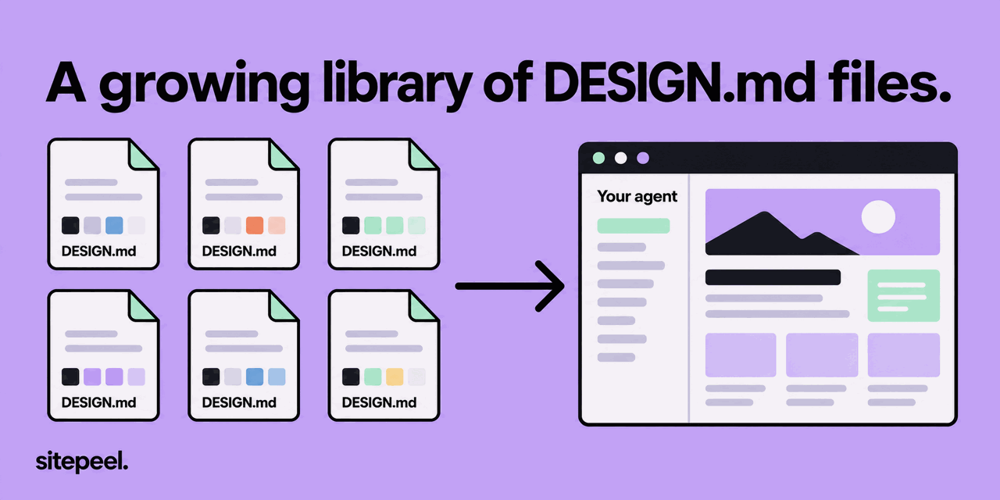
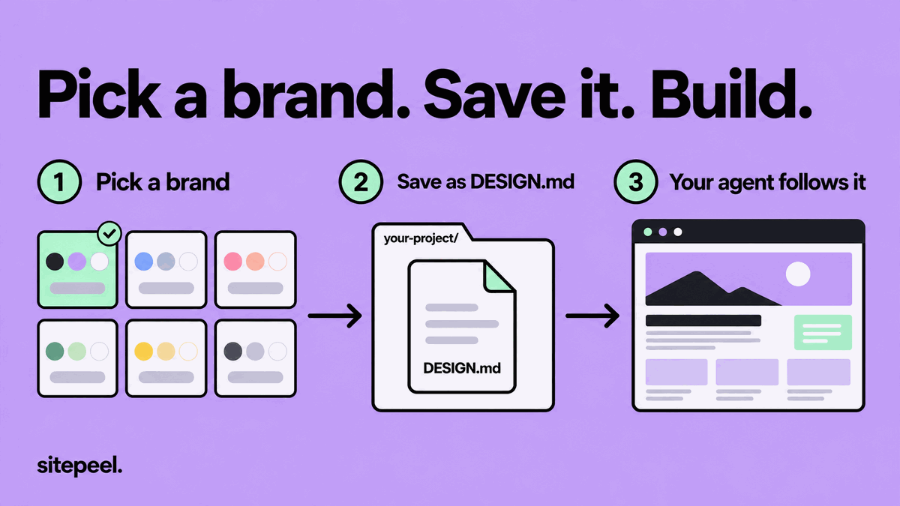
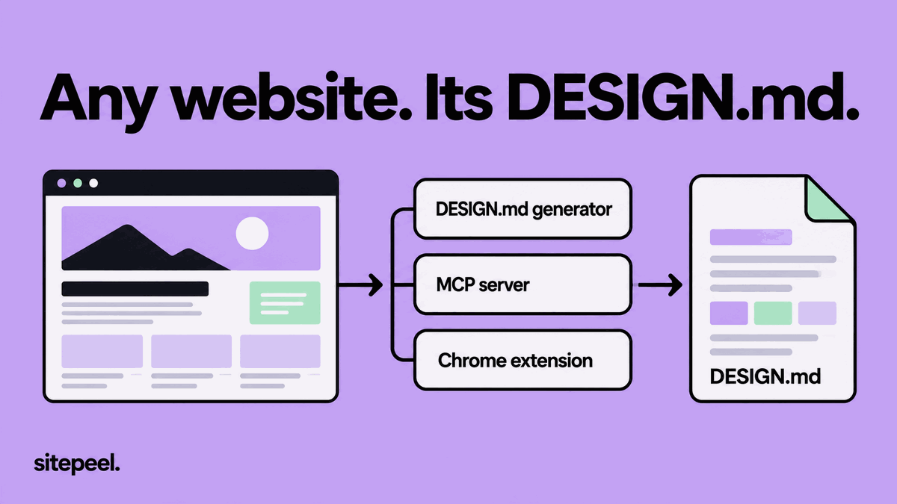
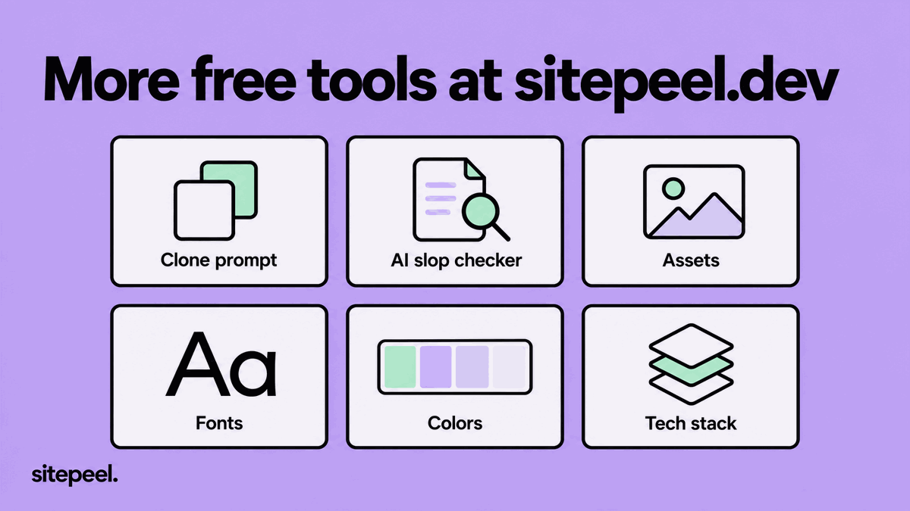

<!-- Generated by scripts/sync.mjs from the Sitepeel library. Edit the script, not this file. -->

<p align="center"><a href="https://sitepeel.dev/design-md/examples/"></a></p>

<h1 align="center">DESIGN.md library</h1>

<p align="center">A growing library of free DESIGN.md files for AI coding agents.<br>168 websites so far, measured by <a href="https://sitepeel.dev">Sitepeel</a> and updated every day.</p>

<p align="center">
  <a href="https://sitepeel.dev/design-md/"><b>Generate a DESIGN.md</b></a> ·
  <a href="https://sitepeel.dev/design-md/examples/">Browse with style guides</a> ·
  <a href="https://sitepeel.dev/mcp/">MCP server</a> ·
  <a href="https://sitepeel.dev/extension/">Chrome extension</a> ·
  <a href="https://sitepeel.dev">sitepeel.dev</a>
</p>

<p align="center">
  <a href="#all-brands"></a>
  <a href="https://github.com/Josephbadigar/design-md/actions/workflows/sync.yml"></a>
  <a href="LICENSE"></a>
</p>

DESIGN.md is a plain-text design system in the format Google published with Stitch. Colors, fonts, spacing and component tokens sit at the top of the file, with short rules underneath. AI coding agents such as Claude Code, Cursor, Codex and Stitch read it to build UI in a set style. This library has 168 of them so far, for sites like Stripe, Linear and Vercel, and it grows as people make new ones on [Sitepeel](https://sitepeel.dev). Each file is measured from the live site. You can browse the same library, with a style guide for every brand, at [sitepeel.dev/design-md/examples](https://sitepeel.dev/design-md/examples/).

<table>
<tr><td align="center" width="33%"><a href="design-md/stripe.com/"></a><br><a href="design-md/stripe.com/"><b>Stripe</b></a> · <a href="design-md/stripe.com/DESIGN.md">DESIGN.md</a></td><td align="center" width="33%"><a href="design-md/linear.app/"></a><br><a href="design-md/linear.app/"><b>Linear</b></a> · <a href="design-md/linear.app/DESIGN.md">DESIGN.md</a></td><td align="center" width="33%"><a href="design-md/vercel.com/"></a><br><a href="design-md/vercel.com/"><b>Vercel</b></a> · <a href="design-md/vercel.com/DESIGN.md">DESIGN.md</a></td></tr>
<tr><td align="center" width="33%"><a href="design-md/notion.com/"></a><br><a href="design-md/notion.com/"><b>Notion</b></a> · <a href="design-md/notion.com/DESIGN.md">DESIGN.md</a></td><td align="center" width="33%"><a href="design-md/figma.com/"></a><br><a href="design-md/figma.com/"><b>Figma</b></a> · <a href="design-md/figma.com/DESIGN.md">DESIGN.md</a></td><td align="center" width="33%"><a href="design-md/apple.com/"></a><br><a href="design-md/apple.com/"><b>Apple</b></a> · <a href="design-md/apple.com/DESIGN.md">DESIGN.md</a></td></tr>
<tr><td align="center" width="33%"><a href="design-md/anthropic.com/"></a><br><a href="design-md/anthropic.com/"><b>Anthropic</b></a> · <a href="design-md/anthropic.com/DESIGN.md">DESIGN.md</a></td><td align="center" width="33%"><a href="design-md/cursor.com/"></a><br><a href="design-md/cursor.com/"><b>Cursor</b></a> · <a href="design-md/cursor.com/DESIGN.md">DESIGN.md</a></td><td align="center" width="33%"><a href="design-md/supabase.com/"></a><br><a href="design-md/supabase.com/"><b>Supabase</b></a> · <a href="design-md/supabase.com/DESIGN.md">DESIGN.md</a></td></tr>
</table>

**Don't see your site?** [Generate its DESIGN.md](https://sitepeel.dev/design-md/) from any link in under a minute, free.

- [How to use](#how-to-use)
- [Generate a DESIGN.md for any site](#generate-a-designmd-for-any-site)
- [All brands](#all-brands): [AI](#ai) (14), [Developer tools](#developer-tools) (37), [UI and animation libraries](#ui-and-animation-libraries) (7), [SaaS and productivity](#saas-and-productivity) (37), [Fintech and payments](#fintech-and-payments) (13), [Marketing and analytics](#marketing-and-analytics) (11), [Design tools and site builders](#design-tools-and-site-builders) (13), [Inspiration](#inspiration) (7), [E-commerce and brands](#e-commerce-and-brands) (12), [Media and consumer apps](#media-and-consumer-apps) (14), [Security and privacy](#security-and-privacy) (3)
- [About Sitepeel](#about-sitepeel)
- [Credit and license](#credit-and-license)
- [FAQ](#faq)

## How to use



1. Pick a brand close to what you are building.
2. Save its DESIGN.md in your project's root folder.
3. Tell your agent to follow DESIGN.md for every UI change.

To fetch one from the terminal, for example Linear:

```sh
curl -o DESIGN.md https://raw.githubusercontent.com/Josephbadigar/design-md/main/design-md/linear.app/DESIGN.md
```

Swap `linear.app` for any folder name in the tables below.

## Generate a DESIGN.md for any site



The library grows every day, but not every site is here yet. Sitepeel gives you three ways to make the file yourself:

- The free [DESIGN.md generator](https://sitepeel.dev/design-md/). Paste a link and it measures the live page, with a visual style guide you can share.
- The free [MCP server](https://sitepeel.dev/mcp/), so your agent can call `get_design_md` and `search_design_library` on its own. Add it to Claude Code with:

  ```sh
  claude mcp add --transport http sitepeel https://sitepeel.dev/mcp
  ```

- The [Chrome extension](https://sitepeel.dev/extension/). It reads the page open in your browser, so it also works on pages behind a login.

## All brands

168 brands in 11 categories so far, with more added as the [library on sitepeel.dev](https://sitepeel.dev/design-md/examples/) grows. Colors are listed background first, then surfaces, text and the accent. Open a brand to see its screenshot. Scripts and agents can read the same list from [index.json](index.json).

### AI

14 brands.

| Brand | Theme | Fonts | Colors | Links |
| --- | --- | --- | --- | --- |
| [Anthropic](design-md/anthropic.com/)<br><sub>anthropic.com</sub> | Dark | anthropicSerif, anthropicSans | <sub>#141413 #3B3B3B #262624 #FAF9F5 #E8E6DC</sub> | [DESIGN.md](design-md/anthropic.com/DESIGN.md), [style guide](https://sitepeel.dev/design-md/anthropic.com/) |
| [bolt.new](design-md/bolt.new/)<br><sub>bolt.new</sub> | Dark | Schibsted Grotesk, Silkscreen | <sub>#111114 #000000 #171719 #FFFFFF #F9F6F9 #2BA6FF</sub> | [DESIGN.md](design-md/bolt.new/DESIGN.md), [style guide](https://sitepeel.dev/design-md/bolt.new/) |
| [Cursor](design-md/cursor.com/)<br><sub>cursor.com</sub> | Dark | CursorGothic, EB Garamond | <sub>#14120B #201E18 #1B1913 #EDECEC #969592 #F54E00</sub> | [DESIGN.md](design-md/cursor.com/DESIGN.md), [style guide](https://sitepeel.dev/design-md/cursor.com/) |
| [DeepL](design-md/deepl.com/)<br><sub>deepl.com</sub> | Light | robotoLatin | <sub>#FFFFFF #DEFDEE #F8F8F8 #191919 #091A2B #0F2B46</sub> | [DESIGN.md](design-md/deepl.com/DESIGN.md), [style guide](https://sitepeel.dev/design-md/deepl.com/) |
| [ElevenLabs](design-md/elevenlabs.io/)<br><sub>elevenlabs.io</sub> | Light | Waldenburg, Inter | <sub>#F5F3F1 #FFFFFF #FDFCFC #000000 #777169 #0A59D2</sub> | [DESIGN.md](design-md/elevenlabs.io/DESIGN.md), [style guide](https://sitepeel.dev/design-md/elevenlabs.io/) |
| [Granola](design-md/granola.ai/)<br><sub>granola.ai</sub> | Light | quadrant, melange | <sub>#FFFFFF #EAEBE5 #F7F7F2 #292929 #72726E #B2C248</sub> | [DESIGN.md](design-md/granola.ai/DESIGN.md), [style guide](https://sitepeel.dev/design-md/granola.ai/) |
| [Hugging Face](design-md/huggingface.co/)<br><sub>huggingface.co</sub> | Dark | Source Sans Pro, IBM Plex Mono | <sub>#0B0F19 #101828 #E5E7EB #D1D5DC #2B7FFF</sub> | [DESIGN.md](design-md/huggingface.co/DESIGN.md), [style guide](https://sitepeel.dev/design-md/huggingface.co/) |
| [Mistral](design-md/mistral.ai/)<br><sub>mistral.ai</sub> | Dark | ALTMistral, Inter | <sub>#101013 #1A1A1E #FAFAF4 #A1A1AA #FFAF01 #FF8204</sub> | [DESIGN.md](design-md/mistral.ai/DESIGN.md), [style guide](https://sitepeel.dev/design-md/mistral.ai/) |
| [Perplexity AI](design-md/perplexity.ai/)<br><sub>perplexity.ai</sub> | Dark | pplxSans | <sub>#15191D #1A1E21 #081F22 #DADFE3 #959A9E #016A71</sub> | [DESIGN.md](design-md/perplexity.ai/DESIGN.md), [style guide](https://sitepeel.dev/design-md/perplexity.ai/) |
| [Replicate](design-md/replicate.com/)<br><sub>replicate.com</sub> | Dark | rb-freigeist-neue, basier-square | <sub>#111111 #1B180F #181111 #EEEEEE #B4B4B4 #FFFFFF</sub> | [DESIGN.md](design-md/replicate.com/DESIGN.md), [style guide](https://sitepeel.dev/design-md/replicate.com/) |
| [Runway](design-md/runwayml.com/)<br><sub>runwayml.com</sub> | Light | abcNormal | <sub>#FFFFFF #EEF1F5 #F7F7F7 #404040 #1A1A1A #2B22FA</sub> | [DESIGN.md](design-md/runwayml.com/DESIGN.md), [style guide](https://sitepeel.dev/design-md/runwayml.com/) |
| [Suno](design-md/suno.com/)<br><sub>suno.com</sub> | Dark | Neue Montreal, Editorial New | <sub>#101012 #000000 #F7F4EF #FCFBF9 #02D95C #1F8BFF</sub> | [DESIGN.md](design-md/suno.com/DESIGN.md), [style guide](https://sitepeel.dev/design-md/suno.com/) |
| [Synthesia](design-md/synthesia.io/)<br><sub>synthesia.io</sub> | Light | Basiersquare Webfont | <sub>#FFFFFF #F7F7F7 #363636 #68686A #771A0D #3E57DA</sub> | [DESIGN.md](design-md/synthesia.io/DESIGN.md), [style guide](https://sitepeel.dev/design-md/synthesia.io/) |
| [v0](design-md/v0.app/)<br><sub>v0.app</sub> | Dark | GeistSans, Inter | <sub>#000000 #121212 #0A0A0A #EDEDED #A0A0A0</sub> | [DESIGN.md](design-md/v0.app/DESIGN.md), [style guide](https://sitepeel.dev/design-md/v0.app/) |

### Developer tools

37 brands.

| Brand | Theme | Fonts | Colors | Links |
| --- | --- | --- | --- | --- |
| [Astro](design-md/astro.build/)<br><sub>astro.build</sub> | Dark | Obviously | <sub>#060913 #0C0F19 #0D0F14 #F2F6FA #BFC1C9 #1A1367</sub> | [DESIGN.md](design-md/astro.build/DESIGN.md), [style guide](https://sitepeel.dev/design-md/astro.build/) |
| [Auth0](design-md/auth0.com/)<br><sub>auth0.com</sub> | Dark | Aeonik, Aeonik Mono | <sub>#20003A #120021 #FFFFFF #E5E5E5 #BCBAFF</sub> | [DESIGN.md](design-md/auth0.com/DESIGN.md), [style guide](https://sitepeel.dev/design-md/auth0.com/) |
| [Bun](design-md/bun.sh/)<br><sub>bun.sh</sub> | Dark | Archivo | <sub>#0D0A0C #000000 #0E0E0E #EAEAE8 #A8A8A5 #FF2E97</sub> | [DESIGN.md](design-md/bun.sh/DESIGN.md), [style guide](https://sitepeel.dev/design-md/bun.sh/) |
| [Clerk](design-md/clerk.com/)<br><sub>clerk.com</sub> | Light | geistNumbers | <sub>#FFFFFF #EEEEF0 #F7F7F8 #131316 #5E5F6E #42434D</sub> | [DESIGN.md](design-md/clerk.com/DESIGN.md), [style guide](https://sitepeel.dev/design-md/clerk.com/) |
| [Cloudflare](design-md/cloudflare.com/)<br><sub>cloudflare.com</sub> | Light | STK Bureau Sans | <sub>#FF5E1F #1F1F1F #FFFBF5 #FF5F08 #FF9910</sub> | [DESIGN.md](design-md/cloudflare.com/DESIGN.md), [style guide](https://sitepeel.dev/design-md/cloudflare.com/) |
| [Datadog](design-md/datadoghq.com/)<br><sub>datadoghq.com</sub> | Light | NationalWeb | <sub>#FFFFFF #F6F6F6 #212529 #555555 #632CA6 #9EC5FE</sub> | [DESIGN.md](design-md/datadoghq.com/DESIGN.md), [style guide](https://sitepeel.dev/design-md/datadoghq.com/) |
| [Deno](design-md/deno.com/)<br><sub>deno.com</sub> | Dark | Inter, Menlo | <sub>#001319 #25272B #121417 #868789 #9EA0A5 #F5F5F5</sub> | [DESIGN.md](design-md/deno.com/DESIGN.md), [style guide](https://sitepeel.dev/design-md/deno.com/) |
| [Docker](design-md/docker.com/)<br><sub>docker.com</sub> | Light | Repro, Inter | <sub>#F9FAFB #F0F0F0 #FFFFFF #2C333F #475569 #2560FF</sub> | [DESIGN.md](design-md/docker.com/DESIGN.md), [style guide](https://sitepeel.dev/design-md/docker.com/) |
| [Flutter](design-md/flutter.dev/)<br><sub>flutter.dev</sub> | Dark | Google Sans Flex | <sub>#1A68D3 #FFFFFF #000000 #14C2AD</sub> | [DESIGN.md](design-md/flutter.dev/DESIGN.md), [style guide](https://sitepeel.dev/design-md/flutter.dev/) |
| [Fly.io](design-md/fly.io/)<br><sub>fly.io</sub> | Light | Mackinac, Fricolage Grotesque | <sub>#F4F6EB #FFFFFF #5B5077 #686082 #7C3AED #CAE3FD</sub> | [DESIGN.md](design-md/fly.io/DESIGN.md), [style guide](https://sitepeel.dev/design-md/fly.io/) |
| [GitHub](design-md/github.com/)<br><sub>github.com</sub> | Dark | Mona Sans, Mona Sans VF | <sub>#000000 #0D1117 #090D0A #FFFFFF #A4AEA6 #080A3D</sub> | [DESIGN.md](design-md/github.com/DESIGN.md), [style guide](https://sitepeel.dev/design-md/github.com/) |
| [GitLab](design-md/gitlab.com/)<br><sub>gitlab.com</sub> | Dark | GitLab Sans, GitLab Mono | <sub>#171321 #FFFFFF #F7F7F5 #FC6D26 #FCA326</sub> | [DESIGN.md](design-md/gitlab.com/DESIGN.md), [style guide](https://sitepeel.dev/design-md/gitlab.com/) |
| [Go](design-md/go.dev/)<br><sub>go.dev</sub> | Dark | Roboto | <sub>#202224 #253443 #2D2D2D #F0F1F2 #AAACAE #007D9C</sub> | [DESIGN.md](design-md/go.dev/DESIGN.md), [style guide](https://sitepeel.dev/design-md/go.dev/) |
| [Grafana Labs](design-md/grafana.com/)<br><sub>grafana.com</sub> | Light | Poppins, Inter | <sub>#F4F4F6 #F9F9FA #EAF0FF #000000 #2E2E38 #1B55F5</sub> | [DESIGN.md](design-md/grafana.com/DESIGN.md), [style guide](https://sitepeel.dev/design-md/grafana.com/) |
| [MongoDB](design-md/mongodb.com/)<br><sub>mongodb.com</sub> | Dark | Sohne Condensed, Sohne | <sub>#061621 #081B28 #FFFFFF #FDFEEC #00ED64 #016BF8</sub> | [DESIGN.md](design-md/mongodb.com/DESIGN.md), [style guide](https://sitepeel.dev/design-md/mongodb.com/) |
| [Neon](design-md/neon.tech/)<br><sub>neon.tech</sub> | Dark | Inter, GeistMono | <sub>#000000 #151617 #111315 #FFFFFF #C9CBCF #34D59A</sub> | [DESIGN.md](design-md/neon.tech/DESIGN.md), [style guide](https://sitepeel.dev/design-md/neon.tech/) |
| [Netlify](design-md/netlify.com/)<br><sub>netlify.com</sub> | Dark | Figtree, Instrument Sans | <sub>#12181F #181A1C #DEFFFE #E4F0FB #32E6E2 #89DDFF</sub> | [DESIGN.md](design-md/netlify.com/DESIGN.md), [style guide](https://sitepeel.dev/design-md/netlify.com/) |
| [Next.js](design-md/nextjs.org/)<br><sub>nextjs.org</sub> | Dark | GeistSans | <sub>#000000 #292929 #0A0A0A #EDEDED #A1A1A1 #0057FF</sub> | [DESIGN.md](design-md/nextjs.org/DESIGN.md), [style guide](https://sitepeel.dev/design-md/nextjs.org/) |
| [Node.js](design-md/nodejs.org/)<br><sub>nodejs.org</sub> | Dark | OPEN SANS, SFMono-Regular | <sub>#0D121C #2C3437 #FFFFFF #ECEFF4 #AE5F00 #84BA64</sub> | [DESIGN.md](design-md/nodejs.org/DESIGN.md), [style guide](https://sitepeel.dev/design-md/nodejs.org/) |
| [Postman](design-md/postman.com/)<br><sub>postman.com</sub> | Light | gtStandard | <sub>#FF6C37 #212121 #FFFFFF #E0531F #FF8A5C</sub> | [DESIGN.md](design-md/postman.com/DESIGN.md), [style guide](https://sitepeel.dev/design-md/postman.com/) |
| [Prisma](design-md/prisma.io/)<br><sub>prisma.io</sub> | Light | Sora, Inter | <sub>#FFFFFF #F4F7F7 #DCFDFF #3A3B3C #646567 #000000</sub> | [DESIGN.md](design-md/prisma.io/DESIGN.md), [style guide](https://sitepeel.dev/design-md/prisma.io/) |
| [Python.org](design-md/python.org/)<br><sub>python.org</sub> | Light | Flux-Regular, SourceSansProBold | <sub>#F9F9F9 #E6E8EA #FFFFFF #444444 #4D4D4D #2B5B84</sub> | [DESIGN.md](design-md/python.org/DESIGN.md), [style guide](https://sitepeel.dev/design-md/python.org/) |
| [Railway](design-md/railway.com/)<br><sub>railway.com</sub> | Dark | IBM Plex Serif, Inter | <sub>#13111C #291839 #1C1A28 #FFFFFF #F7F7F8 #553F83</sub> | [DESIGN.md](design-md/railway.com/DESIGN.md), [style guide](https://sitepeel.dev/design-md/railway.com/) |
| [React](design-md/react.dev/)<br><sub>react.dev</sub> | Dark | Optimistic Display, Optimistic Text | <sub>#23272F #343A46 #FFFFFF #F6F7F9 #58C4DC #77B7D7</sub> | [DESIGN.md](design-md/react.dev/DESIGN.md), [style guide](https://sitepeel.dev/design-md/react.dev/) |
| [Redis](design-md/redis.io/)<br><sub>redis.io</sub> | Dark | primaryFont, Space Grotesk | <sub>#091A23 #351D22 #0D212C #FFFFFF #B9C2C6 #DCFF1E</sub> | [DESIGN.md](design-md/redis.io/DESIGN.md), [style guide](https://sitepeel.dev/design-md/redis.io/) |
| [Render](design-md/render.com/)<br><sub>render.com</sub> | Dark | Roobert, PPNeueMontreal | <sub>#0D0D0D #FFFFFF #E3E3E3 #1C0037 #D1B8FF #8A05FF</sub> | [DESIGN.md](design-md/render.com/DESIGN.md), [style guide](https://sitepeel.dev/design-md/render.com/) |
| [Resend](design-md/resend.com/)<br><sub>resend.com</sub> | Dark | domaine, aBCFavorit | <sub>#000000 #0B0E14 #F0F0F0 #ABAFB4 #3B9EFF</sub> | [DESIGN.md](design-md/resend.com/DESIGN.md), [style guide](https://sitepeel.dev/design-md/resend.com/) |
| [Retool](design-md/retool.com/)<br><sub>retool.com</sub> | Dark | saansFont, pxGroteskFont | <sub>#151515 #242424 #E9EBDF #CBCCC4 #ECA438 #EF4444</sub> | [DESIGN.md](design-md/retool.com/DESIGN.md), [style guide](https://sitepeel.dev/design-md/retool.com/) |
| [Rust](design-md/rust-lang.org/)<br><sub>rust-lang.org</sub> | Dark | Alfa Slab One, Fira Sans | <sub>#0B7261 #000000 #2A3439 #4299BF</sub> | [DESIGN.md](design-md/rust-lang.org/DESIGN.md), [style guide](https://sitepeel.dev/design-md/rust-lang.org/) |
| [Sentry](design-md/sentry.io/)<br><sub>sentry.io</sub> | Dark | Dammit Sans, Rubik | <sub>#1F1633 #FFFFFF #6A5FC1 #FD44B0 #C2EF4E</sub> | [DESIGN.md](design-md/sentry.io/DESIGN.md), [style guide](https://sitepeel.dev/design-md/sentry.io/) |
| [Supabase](design-md/supabase.com/)<br><sub>supabase.com</sub> | Dark | Manrope, Inter | <sub>#131413 #181A19 #0C0F24 #EDEFEE #BCBDBC #006338</sub> | [DESIGN.md](design-md/supabase.com/DESIGN.md), [style guide](https://sitepeel.dev/design-md/supabase.com/) |
| [Svelte](design-md/svelte.dev/)<br><sub>svelte.dev</sub> | Dark | DM Serif Display, Fira Sans | <sub>#1C1E22 #2E333E #23272F #CACBCE #E5E5E6 #F96743</sub> | [DESIGN.md](design-md/svelte.dev/DESIGN.md), [style guide](https://sitepeel.dev/design-md/svelte.dev/) |
| [Twilio](design-md/twilio.com/)<br><sub>twilio.com</sub> | Light | Buffalo, Whitney SSm | <sub>#FFFFFF #000D25 #7E869C #1866EE #DB132A #030B5D</sub> | [DESIGN.md](design-md/twilio.com/DESIGN.md), [style guide](https://sitepeel.dev/design-md/twilio.com/) |
| [TypeScript](design-md/typescriptlang.org/)<br><sub>typescriptlang.org</sub> | Dark | Segoe UI Web (West European), JetBrains Mono | <sub>#3178C6 #FFFFFF #000000 #235A97 #F7CBA4</sub> | [DESIGN.md](design-md/typescriptlang.org/DESIGN.md), [style guide](https://sitepeel.dev/design-md/typescriptlang.org/) |
| [Vercel](design-md/vercel.com/)<br><sub>vercel.com</sub> | Dark | GeistSans, Geist Mono | <sub>#000000 #262626 #0A0A0A #EDEDED #A1A1A1</sub> | [DESIGN.md](design-md/vercel.com/DESIGN.md), [style guide](https://sitepeel.dev/design-md/vercel.com/) |
| [Vite](design-md/vite.dev/)<br><sub>vite.dev</sub> | Dark | APK Protocol, Inter | <sub>#16171D #14121A #FFFFFF #BABABC #9AC8FF #B39AFF</sub> | [DESIGN.md](design-md/vite.dev/DESIGN.md), [style guide](https://sitepeel.dev/design-md/vite.dev/) |
| [Vue.js](design-md/vuejs.org/)<br><sub>vuejs.org</sub> | Dark | Inter var experimental | <sub>#1A1A1A #2F2F2F #242424 #E1E1E1 #AAC8E4 #42D392</sub> | [DESIGN.md](design-md/vuejs.org/DESIGN.md), [style guide](https://sitepeel.dev/design-md/vuejs.org/) |

### UI and animation libraries

7 brands.

| Brand | Theme | Fonts | Colors | Links |
| --- | --- | --- | --- | --- |
| [GSAP](design-md/gsap.com/)<br><sub>gsap.com</sub> | Dark | Mori | <sub>#0E100F #000000 #FFFCE1 #FEC5FB #9D95FF #FF8709</sub> | [DESIGN.md](design-md/gsap.com/DESIGN.md), [style guide](https://sitepeel.dev/design-md/gsap.com/) |
| [Motion](design-md/motion.dev/)<br><sub>motion.dev</sub> | Dark | TASA Orbiter | <sub>#080808 #0E1312 #000000 #EDEBE5 #979D97 #FBD509</sub> | [DESIGN.md](design-md/motion.dev/DESIGN.md), [style guide](https://sitepeel.dev/design-md/motion.dev/) |
| [MUI](design-md/mui.com/)<br><sub>mui.com</sub> | Dark | General Sans, IBM Plex Sans | <sub>#0F1214 #3B3B3B #303840 #FFFFFF #CCE6FF #0073E6</sub> | [DESIGN.md](design-md/mui.com/DESIGN.md), [style guide](https://sitepeel.dev/design-md/mui.com/) |
| [Radix UI](design-md/radix-ui.com/)<br><sub>radix-ui.com</sub> | Dark | adobeTextPro | <sub>#111113 #EDEEF0 #B0B4BA #3E63DD #9EB1FF</sub> | [DESIGN.md](design-md/radix-ui.com/DESIGN.md), [style guide](https://sitepeel.dev/design-md/radix-ui.com/) |
| [shadcn/ui](design-md/ui.shadcn.com/)<br><sub>ui.shadcn.com</sub> | Dark | Geist | <sub>#0A0A0A #262626 #171717 #FAFAFA #A1A1A1 #E5E5E5</sub> | [DESIGN.md](design-md/ui.shadcn.com/DESIGN.md), [style guide](https://sitepeel.dev/design-md/ui.shadcn.com/) |
| [Storybook](design-md/storybook.js.org/)<br><sub>storybook.js.org</sub> | Dark | Nunito Sans | <sub>#0D1026 #020617 #0F172A #FFFFFF #94A3B8 #029CFD</sub> | [DESIGN.md](design-md/storybook.js.org/DESIGN.md), [style guide](https://sitepeel.dev/design-md/storybook.js.org/) |
| [Tailwind CSS](design-md/tailwindcss.com/)<br><sub>tailwindcss.com</sub> | Dark | inter, plexMono | <sub>#030712 #FFFFFF #CAD5E2 #00BCFF #FB64B6 #74D4FF</sub> | [DESIGN.md](design-md/tailwindcss.com/DESIGN.md), [style guide](https://sitepeel.dev/design-md/tailwindcss.com/) |

### SaaS and productivity

37 brands.

| Brand | Theme | Fonts | Colors | Links |
| --- | --- | --- | --- | --- |
| [37signals](design-md/37signals.com/)<br><sub>37signals.com</sub> | Light | Lab Grotesque | <sub>#F87917 #000000 #FFFFFF #F87918</sub> | [DESIGN.md](design-md/37signals.com/DESIGN.md), [style guide](https://sitepeel.dev/design-md/37signals.com/) |
| [Airtable](design-md/airtable.com/)<br><sub>airtable.com</sub> | Light | ATSeasonSans, SF Pro Text | <sub>#FFFFFF #E0DAFD #EEF0F4 #2E2F32 #1D1F25 #944D37</sub> | [DESIGN.md](design-md/airtable.com/DESIGN.md), [style guide](https://sitepeel.dev/design-md/airtable.com/) |
| [Arc](design-md/arc.net/)<br><sub>arc.net</sub> | Light | Marlin Soft SQ, Marlin | <sub>#FFFCEC #FFFFFF #000000 #3139FB #2702C2 #FF5060</sub> | [DESIGN.md](design-md/arc.net/DESIGN.md), [style guide](https://sitepeel.dev/design-md/arc.net/) |
| [Asana](design-md/asana.com/)<br><sub>asana.com</sub> | Light | TWK Lausanne | <sub>#FFFFFF #F3F3F3 #FAFAFA #0D0D0D #3D3D3D #FFC9FF</sub> | [DESIGN.md](design-md/asana.com/DESIGN.md), [style guide](https://sitepeel.dev/design-md/asana.com/) |
| [Atlassian](design-md/atlassian.com/)<br><sub>atlassian.com</sub> | Dark | Charlie Display, Charlie Text | <sub>#101214 #FFFFFF #1868DB #BAF3DB #7EE2B8</sub> | [DESIGN.md](design-md/atlassian.com/DESIGN.md), [style guide](https://sitepeel.dev/design-md/atlassian.com/) |
| [Attio](design-md/attio.com/)<br><sub>attio.com</sub> | Light | interDisplay, inter | <sub>#FFFFFF #FAFAFB #242629 #2E3238 #202124 #266DF0</sub> | [DESIGN.md](design-md/attio.com/DESIGN.md), [style guide](https://sitepeel.dev/design-md/attio.com/) |
| [Basecamp](design-md/basecamp.com/)<br><sub>basecamp.com</sub> | Dark | Graphik | <sub>#131F25 #1B2930 #0B151B #E1E5E8 #A8AFB3 #117AF3</sub> | [DESIGN.md](design-md/basecamp.com/DESIGN.md), [style guide](https://sitepeel.dev/design-md/basecamp.com/) |
| [Cal.com](design-md/cal.com/)<br><sub>cal.com</sub> | Light | Cal Sans, Cal Sans UI Variable Light | <sub>#FFFFFF #F4F4F4 #F5F5F5 #111111 #242424 #0099FF</sub> | [DESIGN.md](design-md/cal.com/DESIGN.md), [style guide](https://sitepeel.dev/design-md/cal.com/) |
| [Calendly.com](design-md/calendly.com/)<br><sub>calendly.com</sub> | Light | Calendly Sans, Wulkan Text | <sub>#F5F3EE #FFFFFF #FCFBF8 #071A31 #3D464E #C3DFFE</sub> | [DESIGN.md](design-md/calendly.com/DESIGN.md), [style guide](https://sitepeel.dev/design-md/calendly.com/) |
| [ClickUp](design-md/clickup.com/)<br><sub>clickup.com</sub> | Light | Plus Jakarta Sans, Inter | <sub>#FFFFFF #FEEFF6 #E7F9F5 #646464 #8A8A94 #FFC53D</sub> | [DESIGN.md](design-md/clickup.com/DESIGN.md), [style guide](https://sitepeel.dev/design-md/clickup.com/) |
| [Coda](design-md/coda.io/)<br><sub>coda.io</sub> | Light | Calibre-R, Inter | <sub>#FFFFFF #FFF6EC #FCFAF7 #141413 #292827 #FFE6C8</sub> | [DESIGN.md](design-md/coda.io/DESIGN.md), [style guide](https://sitepeel.dev/design-md/coda.io/) |
| [Craft](design-md/craft.do/)<br><sub>craft.do</sub> | Light | UntitledSerifFont, UntitledSansFont | <sub>#FCF9F7 #FFFFFF #030302 #1B1B1A #B8CAF5 #AADAF1</sub> | [DESIGN.md](design-md/craft.do/DESIGN.md), [style guide](https://sitepeel.dev/design-md/craft.do/) |
| [Deel](design-md/deel.com/)<br><sub>deel.com</sub> | Light | BagossExtendedFont, BagossCondensedFont | <sub>#FFFFFF #F7F5F2 #1B1B1B #212121 #5938B7 #B1D8FC</sub> | [DESIGN.md](design-md/deel.com/DESIGN.md), [style guide](https://sitepeel.dev/design-md/deel.com/) |
| [Dropbox](design-md/dropbox.com/)<br><sub>dropbox.com</sub> | Light | Sharp Grotesk, Sharp Grotesk 23 | <sub>#F7F5F2 #FFFFFF #1E1919 #70695E #0061FE #CD2F7B</sub> | [DESIGN.md](design-md/dropbox.com/DESIGN.md), [style guide](https://sitepeel.dev/design-md/dropbox.com/) |
| [Fastmail](design-md/fastmail.com/)<br><sub>fastmail.com</sub> | Light | roca, Proxima Nova | <sub>#FFFFFF #F4F5F5 #FBF7EF #1B1E20 #5B646C #253859</sub> | [DESIGN.md](design-md/fastmail.com/DESIGN.md), [style guide](https://sitepeel.dev/design-md/fastmail.com/) |
| [Folk](design-md/folk.app/)<br><sub>folk.app</sub> | Light | Uxumgrotesque, Inter | <sub>#FFFFFF #1F1E1C #333333 #FFC53D #8145B5</sub> | [DESIGN.md](design-md/folk.app/DESIGN.md), [style guide](https://sitepeel.dev/design-md/folk.app/) |
| [HEY](design-md/hey.com/)<br><sub>hey.com</sub> | Dark | Really Sans Large, Moniker | <sub>#202C38 #333C47 #17212B #ECE9E6 #8C85FF</sub> | [DESIGN.md](design-md/hey.com/DESIGN.md), [style guide](https://sitepeel.dev/design-md/hey.com/) |
| [Lattice](design-md/lattice.com/)<br><sub>lattice.com</sub> | Light | Matter | <sub>#FFFFFF #F7F6F2 #FAF9F7 #001F1F #003D3D #B1F0E7</sub> | [DESIGN.md](design-md/lattice.com/DESIGN.md), [style guide](https://sitepeel.dev/design-md/lattice.com/) |
| [Linear](design-md/linear.app/)<br><sub>linear.app</sub> | Dark | Inter Variable, Berkeley Mono | <sub>#08090A #121414 #0F1011 #F7F8F8 #D0D6E0 #E5E5E6</sub> | [DESIGN.md](design-md/linear.app/DESIGN.md), [style guide](https://sitepeel.dev/design-md/linear.app/) |
| [Loom](design-md/loom.com/)<br><sub>loom.com</sub> | Light | Charlie Display, Charlie Text | <sub>#FFFFFF #E9F2FE #F8EEFE #101214 #292A2E #1868DB</sub> | [DESIGN.md](design-md/loom.com/DESIGN.md), [style guide](https://sitepeel.dev/design-md/loom.com/) |
| [Make](design-md/make.com/)<br><sub>make.com</sub> | Light | Satoshi | <sub>#FFFFFF #FAFAFA #342237 #69586C #8F4BD2 #E1B9F9</sub> | [DESIGN.md](design-md/make.com/DESIGN.md), [style guide](https://sitepeel.dev/design-md/make.com/) |
| [Miro](design-md/miro.com/)<br><sub>miro.com</sub> | Light | Roobert PRO Medium, Noto Sans | <sub>#FFFFFF #FDE0F0 #F0F0F0 #000000 #1C1C1E #FDE050</sub> | [DESIGN.md](design-md/miro.com/DESIGN.md), [style guide](https://sitepeel.dev/design-md/miro.com/) |
| [monday.com](design-md/monday.com/)<br><sub>monday.com</sub> | Light | Poppins | <sub>#FFFFFF #CCCCCC #F3F4F5 #000000 #535768 #6161FF</sub> | [DESIGN.md](design-md/monday.com/DESIGN.md), [style guide](https://sitepeel.dev/design-md/monday.com/) |
| [n8n](design-md/n8n.io/)<br><sub>n8n.io</sub> | Light | n8n Baumer Uniwidth, Inter | <sub>#FAFAFA #E6E6E6 #F0F0F0 #161616 #212121 #FFBCCA</sub> | [DESIGN.md](design-md/n8n.io/DESIGN.md), [style guide](https://sitepeel.dev/design-md/n8n.io/) |
| [Notion](design-md/notion.com/)<br><sub>notion.com</sub> | Light | NotionInter | <sub>#FFFFFF #E6F3FE #F9F9F8 #0D0D0D #1A1A1A #0075DE</sub> | [DESIGN.md](design-md/notion.com/DESIGN.md), [style guide](https://sitepeel.dev/design-md/notion.com/) |
| [Obsidian](design-md/obsidian.md/)<br><sub>obsidian.md</sub> | Dark | system fonts | <sub>#0F0F0F #404040 #1F1F1F #EEEEEE #BCBCBC #A88BFA</sub> | [DESIGN.md](design-md/obsidian.md/DESIGN.md), [style guide](https://sitepeel.dev/design-md/obsidian.md/) |
| [Plain](design-md/plain.com/)<br><sub>plain.com</sub> | Light | ABC Favorit Regular, ABC Favorit Medium | <sub>#FFFFFF #000000 #0A2414 #1AD379 #F14A4A</sub> | [DESIGN.md](design-md/plain.com/DESIGN.md), [style guide](https://sitepeel.dev/design-md/plain.com/) |
| [Raycast](design-md/raycast.com/)<br><sub>raycast.com</sub> | Dark | Inter, Segoe UI Variable | <sub>#07080A #111214 #130D0E #FFFFFF #9C9C9D #FF6363</sub> | [DESIGN.md](design-md/raycast.com/DESIGN.md), [style guide](https://sitepeel.dev/design-md/raycast.com/) |
| [Rippling](design-md/rippling.com/)<br><sub>rippling.com</sub> | Dark | basel | <sub>#4A0039 #000000 #C9B3C4 #000088 #7A005D</sub> | [DESIGN.md](design-md/rippling.com/DESIGN.md), [style guide](https://sitepeel.dev/design-md/rippling.com/) |
| [Slack](design-md/slack.com/)<br><sub>slack.com</sub> | Light | Salesforce-Avant-Garde, Salesforce-Sans | <sub>#FFFFFF #F9F0FF #000000 #1D1D1D #730394 #481A54</sub> | [DESIGN.md](design-md/slack.com/DESIGN.md), [style guide](https://sitepeel.dev/design-md/slack.com/) |
| [Superhuman](design-md/superhuman.com/)<br><sub>superhuman.com</sub> | Light | Super Sans VF | <sub>#FFFFFF #F2F0EB #F7F5F2 #292827 #666665 #714CB6</sub> | [DESIGN.md](design-md/superhuman.com/DESIGN.md), [style guide](https://sitepeel.dev/design-md/superhuman.com/) |
| [Todoist](design-md/todoist.com/)<br><sub>todoist.com</sub> | Light | Graphik, Inter | <sub>#FEFDFC #F9F7F6 #FFFFFF #25221E #6F6D6A #E34432</sub> | [DESIGN.md](design-md/todoist.com/DESIGN.md), [style guide](https://sitepeel.dev/design-md/todoist.com/) |
| [Trello](design-md/trello.com/)<br><sub>trello.com</sub> | Light | Charlie Display, Charlie Text | <sub>#F4F5F7 #FFFFFF #F0F0F0 #091E42 #172B4D #0065FF</sub> | [DESIGN.md](design-md/trello.com/DESIGN.md), [style guide](https://sitepeel.dev/design-md/trello.com/) |
| [Twenty](design-md/twenty.com/)<br><sub>twenty.com</sub> | Light | aleo, hostGrotesk | <sub>#F4F4F4 #F9F9F9 #EEF4F1 #1C1C1C #333333 #FF5F57</sub> | [DESIGN.md](design-md/twenty.com/DESIGN.md), [style guide](https://sitepeel.dev/design-md/twenty.com/) |
| [Typefully](design-md/typefully.com/)<br><sub>typefully.com</sub> | Dark | Inter, inter-arrows-subset | <sub>#111418 #282B31 #C4C9D4 #8B94A7 #199AF5 #00E5CC</sub> | [DESIGN.md](design-md/typefully.com/DESIGN.md), [style guide](https://sitepeel.dev/design-md/typefully.com/) |
| [Zapier](design-md/zapier.com/)<br><sub>zapier.com</sub> | Light | Degular Display, Inter | <sub>#FFFEFB #ECEAE3 #F8F4F0 #201515 #36342E #FF4F00</sub> | [DESIGN.md](design-md/zapier.com/DESIGN.md), [style guide](https://sitepeel.dev/design-md/zapier.com/) |
| [Zoom](design-md/zoom.us/)<br><sub>zoom.us</sub> | Light | Newsreader, Inter | <sub>#FFFFFF #E6F0FF #F3F8FF #00053D #181819 #0B5CFF</sub> | [DESIGN.md](design-md/zoom.us/DESIGN.md), [style guide](https://sitepeel.dev/design-md/zoom.us/) |

### Fintech and payments

13 brands.

| Brand | Theme | Fonts | Colors | Links |
| --- | --- | --- | --- | --- |
| [Brex](design-md/brex.com/)<br><sub>brex.com</sub> | Light | inter | <sub>#FFFFFF #F3F3F7 #F9F9FB #15191E #60646C #FF3D00</sub> | [DESIGN.md](design-md/brex.com/DESIGN.md), [style guide](https://sitepeel.dev/design-md/brex.com/) |
| [Family](design-md/family.co/)<br><sub>family.co</sub> | Light | Family, Inter | <sub>#FFFFFF #F6F4EF #FBFAF9 #474645 #343433 #0090FF</sub> | [DESIGN.md](design-md/family.co/DESIGN.md), [style guide](https://sitepeel.dev/design-md/family.co/) |
| [Lemonsqueezy](design-md/lemonsqueezy.com/)<br><sub>lemonsqueezy.com</sub> | Dark | Circularpro book, Inter | <sub>#5423E7 #FFFFFF #121217 #7047EB</sub> | [DESIGN.md](design-md/lemonsqueezy.com/DESIGN.md), [style guide](https://sitepeel.dev/design-md/lemonsqueezy.com/) |
| [Mercury](design-md/mercury.com/)<br><sub>mercury.com</sub> | Dark | arcadiaDisplay, arcadia | <sub>#171721 #1E1E2A #EDEDF3 #C3C3CC #5266EB</sub> | [DESIGN.md](design-md/mercury.com/DESIGN.md), [style guide](https://sitepeel.dev/design-md/mercury.com/) |
| [Monzo](design-md/monzo.com/)<br><sub>monzo.com</sub> | Light | MonzoSansDisplay, MonzoSansText | <sub>#FFFFFF #F2F8F3 #6B747B #091723 #FF4F40 #EAA240</sub> | [DESIGN.md](design-md/monzo.com/DESIGN.md), [style guide](https://sitepeel.dev/design-md/monzo.com/) |
| [Paddle](design-md/paddle.com/)<br><sub>paddle.com</sub> | Light | serrifCondensed, Inter | <sub>#F9F8F7 #E8E6E2 #FCFCFC #1C1A15 #FFD400</sub> | [DESIGN.md](design-md/paddle.com/DESIGN.md), [style guide](https://sitepeel.dev/design-md/paddle.com/) |
| [PayPal](design-md/paypal.com/)<br><sub>paypal.com</sub> | Light | PayPal Pro, PayPal Pro Text VF | <sub>#FFFFFF #F5F7FA #000000 #5E5E5E #002991 #60CDFF</sub> | [DESIGN.md](design-md/paypal.com/DESIGN.md), [style guide](https://sitepeel.dev/design-md/paypal.com/) |
| [Plaid](design-md/plaid.com/)<br><sub>plaid.com</sub> | Light | Plaid Sans, Cern | <sub>#FFFFFF #111111 #00172E #034049 #05565C #CCF8FF</sub> | [DESIGN.md](design-md/plaid.com/DESIGN.md), [style guide](https://sitepeel.dev/design-md/plaid.com/) |
| [Ramp](design-md/ramp.com/)<br><sub>ramp.com</sub> | Light | Lausanne | <sub>#FFFFFF #F4F2F0 #0C0A08 #6D6C6B #1A1919 #E4F222</sub> | [DESIGN.md](design-md/ramp.com/DESIGN.md), [style guide](https://sitepeel.dev/design-md/ramp.com/) |
| [Robinhood](design-md/robinhood.com/)<br><sub>robinhood.com</sub> | Dark | Phonic, Capsule Sans Text | <sub>#000000 #110E08 #FFFFFF #D9D9D9 #CCFF00</sub> | [DESIGN.md](design-md/robinhood.com/DESIGN.md), [style guide](https://sitepeel.dev/design-md/robinhood.com/) |
| [Square](design-md/squareup.com/)<br><sub>squareup.com</sub> | Light | Square Sans Display VF, Exact Block | <sub>#FFFFFF #F7F6F5 #000000 #707070 #004BFF #041EEC</sub> | [DESIGN.md](design-md/squareup.com/DESIGN.md), [style guide](https://sitepeel.dev/design-md/squareup.com/) |
| [Stripe](design-md/stripe.com/)<br><sub>stripe.com</sub> | Light | sohne-var | <sub>#FFFFFF #F5F5FF #F8FAFD #061B31 #50617A #533AFD</sub> | [DESIGN.md](design-md/stripe.com/DESIGN.md), [style guide](https://sitepeel.dev/design-md/stripe.com/) |
| [Wise](design-md/wise.com/)<br><sub>wise.com</sub> | Light | Wise Sans, Inter | <sub>#FFFFFF #163300 #454745 #9FE870 #054D28 #B8232B</sub> | [DESIGN.md](design-md/wise.com/DESIGN.md), [style guide](https://sitepeel.dev/design-md/wise.com/) |

### Marketing and analytics

11 brands.

| Brand | Theme | Fonts | Colors | Links |
| --- | --- | --- | --- | --- |
| [Amplitude](design-md/amplitude.com/)<br><sub>amplitude.com</sub> | Light | Gellix, IBM Plex Sans | <sub>#FFFFFF #F5F7FA #000000 #50565B #1E61F0 #0052F2</sub> | [DESIGN.md](design-md/amplitude.com/DESIGN.md), [style guide](https://sitepeel.dev/design-md/amplitude.com/) |
| [Buffer](design-md/buffer.com/)<br><sub>buffer.com</sub> | Light | Stolzl, Figtree | <sub>#FEFDFB #213130 #4A4A45 #B0EC9C #F3BDFF</sub> | [DESIGN.md](design-md/buffer.com/DESIGN.md), [style guide](https://sitepeel.dev/design-md/buffer.com/) |
| [Dub](design-md/dub.co/)<br><sub>dub.co</sub> | Light | satoshi, Inter | <sub>#FFFFFF #F5F5F5 #FAFAFA #737373 #262626 #000000</sub> | [DESIGN.md](design-md/dub.co/DESIGN.md), [style guide](https://sitepeel.dev/design-md/dub.co/) |
| [Grammarly](design-md/grammarly.com/)<br><sub>grammarly.com</sub> | Light | matter, Matter | <sub>#FFFFFF #F5F5F5 #1F243C #0E101A #027E6F #4285F4</sub> | [DESIGN.md](design-md/grammarly.com/DESIGN.md), [style guide](https://sitepeel.dev/design-md/grammarly.com/) |
| [Hootsuite](design-md/hootsuite.com/)<br><sub>hootsuite.com</sub> | Light | Montserrat | <sub>#FFFFFF #F2F4F5 #012B3A #1F60C9 #7E48EC</sub> | [DESIGN.md](design-md/hootsuite.com/DESIGN.md), [style guide](https://sitepeel.dev/design-md/hootsuite.com/) |
| [HubSpot](design-md/hubspot.com/)<br><sub>hubspot.com</sub> | Light | HubSpot Serif, HubSpot Sans | <sub>#FFFFFF #FCFCFA #1F1F1F #616161 #FF4800 #FCC6B1</sub> | [DESIGN.md](design-md/hubspot.com/DESIGN.md), [style guide](https://sitepeel.dev/design-md/hubspot.com/) |
| [Intercom](design-md/intercom.com/)<br><sub>intercom.com</sub> | Light | Saans, Serrif | <sub>#FFFFFF #D3CEC6 #FAF9F6 #000000 #111111 #0007CB</sub> | [DESIGN.md](design-md/intercom.com/DESIGN.md), [style guide](https://sitepeel.dev/design-md/intercom.com/) |
| [Later](design-md/later.com/)<br><sub>later.com</sub> | Light | Super X sans Display, Inter Tight | <sub>#FFFFFF #F8F2EA #FEFCFB #000000 #FE3F00 #5124C1</sub> | [DESIGN.md](design-md/later.com/DESIGN.md), [style guide](https://sitepeel.dev/design-md/later.com/) |
| [Mailchimp](design-md/mailchimp.com/)<br><sub>mailchimp.com</sub> | Light | Means Web, Graphik Web | <sub>#FFFFFF #F5F5F5 #000000 #231E15 #FFE01B #004E56</sub> | [DESIGN.md](design-md/mailchimp.com/DESIGN.md), [style guide](https://sitepeel.dev/design-md/mailchimp.com/) |
| [Mixpanel](design-md/mixpanel.com/)<br><sub>mixpanel.com</sub> | Light | Garnett Medium, Garnett Regular | <sub>#FFFFFF #F6F6F6 #FAFAFA #1F2023 #2A2A2F #C6B7FF</sub> | [DESIGN.md](design-md/mixpanel.com/DESIGN.md), [style guide](https://sitepeel.dev/design-md/mixpanel.com/) |
| [PostHog](design-md/posthog.com/)<br><sub>posthog.com</sub> | Light | RoundHog | <sub>#EEEFE9 #FFFFFF #374151 #111827 #F54E00 #EB9D2A</sub> | [DESIGN.md](design-md/posthog.com/DESIGN.md), [style guide](https://sitepeel.dev/design-md/posthog.com/) |

### Design tools and site builders

13 brands.

| Brand | Theme | Fonts | Colors | Links |
| --- | --- | --- | --- | --- |
| [Descript](design-md/descript.com/)<br><sub>descript.com</sub> | Dark | brett, gamuthDisplay | <sub>#390A1A #190308 #110A0D #D1C7CB #FFF7FD #F73B3B</sub> | [DESIGN.md](design-md/descript.com/DESIGN.md), [style guide](https://sitepeel.dev/design-md/descript.com/) |
| [Excalidraw](design-md/excalidraw.com/)<br><sub>excalidraw.com</sub> | Light | Times New Roman, Assistant | <sub>#FFFFFF #ECECF4 #F0EFFF #1B1B1F #B8B8B8 #6965DB</sub> | [DESIGN.md](design-md/excalidraw.com/DESIGN.md), [style guide](https://sitepeel.dev/design-md/excalidraw.com/) |
| [Figma](design-md/figma.com/)<br><sub>figma.com</sub> | Light | figmaSans, figmaMono | <sub>#FFFFFF #000000 #00B6FF</sub> | [DESIGN.md](design-md/figma.com/DESIGN.md), [style guide](https://sitepeel.dev/design-md/figma.com/) |
| [Framer](design-md/framer.com/)<br><sub>framer.com</sub> | Dark | GT Walsheim Medium, Inter | <sub>#000000 #FFFFFF #CCCCCC #0099FF #4CD963</sub> | [DESIGN.md](design-md/framer.com/DESIGN.md), [style guide](https://sitepeel.dev/design-md/framer.com/) |
| [LottieFiles](design-md/lottiefiles.com/)<br><sub>lottiefiles.com</sub> | Light | DM Sans LF, Inter LF | <sub>#FFFFFF #FFF8E5 #FAFAFA #09090B #71717B #019D91</sub> | [DESIGN.md](design-md/lottiefiles.com/DESIGN.md), [style guide](https://sitepeel.dev/design-md/lottiefiles.com/) |
| [Pitch](design-md/pitch.com/)<br><sub>pitch.com</sub> | Light | Mark Pro Bold, Mark Pro Regular | <sub>#FFFFFF #EBE3FE #0C021C #C6A5FF #280F62 #5318EB</sub> | [DESIGN.md](design-md/pitch.com/DESIGN.md), [style guide](https://sitepeel.dev/design-md/pitch.com/) |
| [Readymag](design-md/readymag.com/)<br><sub>readymag.com</sub> | Dark | custom 157067 | <sub>#000000 #FFFFFF #444444 #EC520B #C8020A #FF5900</sub> | [DESIGN.md](design-md/readymag.com/DESIGN.md), [style guide](https://sitepeel.dev/design-md/readymag.com/) |
| [Rive](design-md/rive.app/)<br><sub>rive.app</sub> | Dark | Orbitron, Inter | <sub>#000000 #FFFFFF #CCCCCC #E6E6E6</sub> | [DESIGN.md](design-md/rive.app/DESIGN.md), [style guide](https://sitepeel.dev/design-md/rive.app/) |
| [Sketch](design-md/sketch.com/)<br><sub>sketch.com</sub> | Light | Reckless, InterVariable | <sub>#F5F5F5 #FAFAFA #F9F9F9 #212123 #494949 #151515</sub> | [DESIGN.md](design-md/sketch.com/DESIGN.md), [style guide](https://sitepeel.dev/design-md/sketch.com/) |
| [Spline](design-md/spline.design/)<br><sub>spline.design</sub> | Dark | Spline Sans | <sub>#000000 #999999 #E6E6E6 #0062FF</sub> | [DESIGN.md](design-md/spline.design/DESIGN.md), [style guide](https://sitepeel.dev/design-md/spline.design/) |
| [Squarespace](design-md/squarespace.com/)<br><sub>squarespace.com</sub> | Dark | Clarkson, Clarkson Serif | <sub>#000000 #2F2F2F #FFFFFF</sub> | [DESIGN.md](design-md/squarespace.com/DESIGN.md), [style guide](https://sitepeel.dev/design-md/squarespace.com/) |
| [Webflow](design-md/webflow.com/)<br><sub>webflow.com</sub> | Dark | WF Visual Sans Variable | <sub>#080808 #171717 #FFFFFF #ABABAB #146EF5 #3B89FF</sub> | [DESIGN.md](design-md/webflow.com/DESIGN.md), [style guide](https://sitepeel.dev/design-md/webflow.com/) |
| [wix.com](design-md/wix.com/)<br><sub>wix.com</sub> | Light | wix-madefor-display-v2, wix-madefor-text-v2 | <sub>#FFFFFF #000000 #514B3D #9FEAFF #166AEA #1A6AFF</sub> | [DESIGN.md](design-md/wix.com/DESIGN.md), [style guide](https://sitepeel.dev/design-md/wix.com/) |

### Inspiration

7 brands.

| Brand | Theme | Fonts | Colors | Links |
| --- | --- | --- | --- | --- |
| [Are.na](design-md/are.na/)<br><sub>are.na</sub> | Dark | areal | <sub>#000000 #333333 #1A1A1A #FFFFFF #E5E5E5 #E2DFE9</sub> | [DESIGN.md](design-md/are.na/DESIGN.md), [style guide](https://sitepeel.dev/design-md/are.na/) |
| [Awwwards](design-md/awwwards.com/)<br><sub>awwwards.com</sub> | Light | Inter Tight | <sub>#E9E9E9 #F8F8F8 #222222</sub> | [DESIGN.md](design-md/awwwards.com/DESIGN.md), [style guide](https://sitepeel.dev/design-md/awwwards.com/) |
| [Cosmos](design-md/cosmos.so/)<br><sub>cosmos.so</sub> | Light | cosmosOracle | <sub>#F7F5F3 #FCFBFA #F2F1F0 #0D0D0D #6E6A69 #4694F6</sub> | [DESIGN.md](design-md/cosmos.so/DESIGN.md), [style guide](https://sitepeel.dev/design-md/cosmos.so/) |
| [Dribbble](design-md/dribbble.com/)<br><sub>dribbble.com</sub> | Light | Mona Sans, Arial | <sub>#FFFFFF #ECEBF0 #FAF9FB #0D0C22 #524B63 #EA4C89</sub> | [DESIGN.md](design-md/dribbble.com/DESIGN.md), [style guide](https://sitepeel.dev/design-md/dribbble.com/) |
| [Mobbin](design-md/mobbin.com/)<br><sub>mobbin.com</sub> | Light | saans | <sub>#FFFFFF #141414 #707070</sub> | [DESIGN.md](design-md/mobbin.com/DESIGN.md), [style guide](https://sitepeel.dev/design-md/mobbin.com/) |
| [mymind](design-md/mymind.com/)<br><sub>mymind.com</sub> | Light | Avenir LT W01 45 Book1475508, Louize-Regular-205TF | <sub>#F9FAFC #FFF1F1 #FFFFFF #000000 #3A475A #FF5924</sub> | [DESIGN.md](design-md/mymind.com/DESIGN.md), [style guide](https://sitepeel.dev/design-md/mymind.com/) |
| [Savee](design-md/savee.com/)<br><sub>savee.com</sub> | Dark | saveeFont | <sub>#0A0A0A #151515 #D4D4D4 #9C9C9C #FDFDFD</sub> | [DESIGN.md](design-md/savee.com/DESIGN.md), [style guide](https://sitepeel.dev/design-md/savee.com/) |

### E-commerce and brands

12 brands.

| Brand | Theme | Fonts | Colors | Links |
| --- | --- | --- | --- | --- |
| [Allbirds](design-md/allbirds.com/)<br><sub>allbirds.com</sub> | Light | Self Modern, Geograph | <sub>#ECE9E2 #FFFFFF #000000 #212121</sub> | [DESIGN.md](design-md/allbirds.com/DESIGN.md), [style guide](https://sitepeel.dev/design-md/allbirds.com/) |
| [Apple](design-md/apple.com/)<br><sub>apple.com</sub> | Light | SF Pro Display, SF Pro Text | <sub>#F5F5F7 #FFFFFF #FAFAFC #1D1D1F #313131 #0071E3</sub> | [DESIGN.md](design-md/apple.com/DESIGN.md), [style guide](https://sitepeel.dev/design-md/apple.com/) |
| [Glossier](design-md/glossier.com/)<br><sub>glossier.com</sub> | Light | Apercu | <sub>#FFFFFF #F0F0F0 #F5F5F5 #000000 #666666 #0600FF</sub> | [DESIGN.md](design-md/glossier.com/DESIGN.md), [style guide](https://sitepeel.dev/design-md/glossier.com/) |
| [Gumroad](design-md/gumroad.com/)<br><sub>gumroad.com</sub> | Dark | ABC Favorit, Arial | <sub>#000000 #242423 #FFFFFF #B3B3B3 #FF90E8</sub> | [DESIGN.md](design-md/gumroad.com/DESIGN.md), [style guide](https://sitepeel.dev/design-md/gumroad.com/) |
| [IKEA](design-md/ikea.com/)<br><sub>ikea.com</sub> | Light | Omani Rial | <sub>#FFFEFB #DADADA #FFFFFF #111111 #0058A3 #0000EE</sub> | [DESIGN.md](design-md/ikea.com/DESIGN.md), [style guide](https://sitepeel.dev/design-md/ikea.com/) |
| [Nike](design-md/nike.com/)<br><sub>nike.com</sub> | Light | Nike Futura ND, Helvetica Now Text | <sub>#FFFFFF #111111 #707072</sub> | [DESIGN.md](design-md/nike.com/DESIGN.md), [style guide](https://sitepeel.dev/design-md/nike.com/) |
| [Nothing](design-md/nothing.tech/)<br><sub>nothing.tech</sub> | Light | NType82-Regular, Ndot-Regular | <sub>#F4F4F4 #FFFFFF #040404 #595A5A</sub> | [DESIGN.md](design-md/nothing.tech/DESIGN.md), [style guide](https://sitepeel.dev/design-md/nothing.tech/) |
| [Oura Ring](design-md/ouraring.com/)<br><sub>ouraring.com</sub> | Light | Editorial New, AkkuratLL | <sub>#F7F1E8 #FFFFFF #000000 #4A4741 #2A72DE #253B80</sub> | [DESIGN.md](design-md/ouraring.com/DESIGN.md), [style guide](https://sitepeel.dev/design-md/ouraring.com/) |
| [Rivian](design-md/rivian.com/)<br><sub>rivian.com</sub> | Light | Liga, Adventure | <sub>#ECECEC #FFFFFF #F2F2F2 #151515 #FFAA00 #A15842</sub> | [DESIGN.md](design-md/rivian.com/DESIGN.md), [style guide](https://sitepeel.dev/design-md/rivian.com/) |
| [Shopify](design-md/shopify.com/)<br><sub>shopify.com</sub> | Dark | Shopify-Inter, ui-monospace | <sub>#02090A #000000 #000A1E #FFFFFF #99B3AD</sub> | [DESIGN.md](design-md/shopify.com/DESIGN.md), [style guide](https://sitepeel.dev/design-md/shopify.com/) |
| [Sonos](design-md/sonos.com/)<br><sub>sonos.com</sub> | Light | aktiv-grotesk | <sub>#FFFFFF #F4F4F4 #000000 #2E2E2E</sub> | [DESIGN.md](design-md/sonos.com/DESIGN.md), [style guide](https://sitepeel.dev/design-md/sonos.com/) |
| [teenage engineering](design-md/teenage.engineering/)<br><sub>teenage.engineering</sub> | Dark | te-20 | <sub>#000000 #F1F2F2 #E5E5E5</sub> | [DESIGN.md](design-md/teenage.engineering/DESIGN.md), [style guide](https://sitepeel.dev/design-md/teenage.engineering/) |

### Media and consumer apps

14 brands.

| Brand | Theme | Fonts | Colors | Links |
| --- | --- | --- | --- | --- |
| [Airbnb](design-md/airbnb.com/)<br><sub>airbnb.com</sub> | Light | Airbnb Cereal VF | <sub>#FFFFFF #EBEBEB #F2F2F2 #222222 #FF385C</sub> | [DESIGN.md](design-md/airbnb.com/DESIGN.md), [style guide](https://sitepeel.dev/design-md/airbnb.com/) |
| [BBC](design-md/bbc.com/)<br><sub>bbc.com</sub> | Light | BBC Reith Serif, BBC Reith Sans | <sub>#F8F8F8 #E6E8EA #FFFFFF #000000 #202224 #EB0000</sub> | [DESIGN.md](design-md/bbc.com/DESIGN.md), [style guide](https://sitepeel.dev/design-md/bbc.com/) |
| [Booking.com](design-md/booking.com/)<br><sub>booking.com</sub> | Light | Avenir Next | <sub>#FFFFFF #E7E7E7 #F5F5F5 #1A1A1A #595959 #003B95</sub> | [DESIGN.md](design-md/booking.com/DESIGN.md), [style guide](https://sitepeel.dev/design-md/booking.com/) |
| [Discord](design-md/discord.com/)<br><sub>discord.com</sub> | Dark | Abcgintodiscordnord, Abcgintodiscord | <sub>#1A2081 #FFFFFF #BBBDD9 #5865F2 #161986</sub> | [DESIGN.md](design-md/discord.com/DESIGN.md), [style guide](https://sitepeel.dev/design-md/discord.com/) |
| [Duolingo](design-md/duolingo.com/)<br><sub>duolingo.com</sub> | Light | feather, duolingo-sans | <sub>#FFFFFF #4B4B4B #777777 #A5ED6E #58CC02 #AF623C</sub> | [DESIGN.md](design-md/duolingo.com/DESIGN.md), [style guide](https://sitepeel.dev/design-md/duolingo.com/) |
| [Headspace](design-md/headspace.com/)<br><sub>headspace.com</sub> | Light | Headspace Apercu | <sub>#F9F4F2 #FFFFFF #2D2C2B #44423F #0061EF #1A0C54</sub> | [DESIGN.md](design-md/headspace.com/DESIGN.md), [style guide](https://sitepeel.dev/design-md/headspace.com/) |
| [Netflix](design-md/netflix.com/)<br><sub>netflix.com</sub> | Dark | Netflix Sans | <sub>#000000 #2D2D2D #232323 #FFFFFF #B3B3B3 #E50914</sub> | [DESIGN.md](design-md/netflix.com/DESIGN.md), [style guide](https://sitepeel.dev/design-md/netflix.com/) |
| [Pinterest](design-md/pinterest.com/)<br><sub>pinterest.com</sub> | Light | Pin Sans | <sub>#FFFFFF #E5E5E0 #000000 #62625B #E60023 #4285F4</sub> | [DESIGN.md](design-md/pinterest.com/DESIGN.md), [style guide](https://sitepeel.dev/design-md/pinterest.com/) |
| [Spotify](design-md/spotify.com/)<br><sub>spotify.com</sub> | Dark | SpotifyMixUITitle, SpotifyMixUI | <sub>#121212 #3B3B3B #1F1F1F #B3B3B3 #292929</sub> | [DESIGN.md](design-md/spotify.com/DESIGN.md), [style guide](https://sitepeel.dev/design-md/spotify.com/) |
| [Strava](design-md/strava.com/)<br><sub>strava.com</sub> | Light | Boathouse | <sub>#FFFFFF #F9F8F5 #FAFAFA #000000 #21211F #FC5200</sub> | [DESIGN.md](design-md/strava.com/DESIGN.md), [style guide](https://sitepeel.dev/design-md/strava.com/) |
| [Substack](design-md/substack.com/)<br><sub>substack.com</sub> | Dark | Cahuenga | <sub>#161718 #232525 #1B1C1D #EEEEEE #777777 #FF6719</sub> | [DESIGN.md](design-md/substack.com/DESIGN.md), [style guide](https://sitepeel.dev/design-md/substack.com/) |
| [The Verge](design-md/theverge.com/)<br><sub>theverge.com</sub> | Dark | polySans, fkRomanStandard | <sub>#131313 #313131 #000000 #FFFFFF #E9E9E9 #3CFFD0</sub> | [DESIGN.md](design-md/theverge.com/DESIGN.md), [style guide](https://sitepeel.dev/design-md/theverge.com/) |
| [Uber](design-md/uber.com/)<br><sub>uber.com</sub> | Dark | UberMove | <sub>#000000 #292929 #111111 #FFFFFF #AFAFAF #0000EE</sub> | [DESIGN.md](design-md/uber.com/DESIGN.md), [style guide](https://sitepeel.dev/design-md/uber.com/) |
| [WIRED](design-md/wired.com/)<br><sub>wired.com</sub> | Light | WiredDisplay, Apercu | <sub>#FFFFFF #000000 #1A1A1A #057DBC</sub> | [DESIGN.md](design-md/wired.com/DESIGN.md), [style guide](https://sitepeel.dev/design-md/wired.com/) |

### Security and privacy

3 brands.

| Brand | Theme | Fonts | Colors | Links |
| --- | --- | --- | --- | --- |
| [1Password](design-md/1password.com/)<br><sub>1password.com</sub> | Dark | agileSans | <sub>#1D1D21 #303136 #D2D2D3 #CBB88E #145FE4</sub> | [DESIGN.md](design-md/1password.com/DESIGN.md), [style guide](https://sitepeel.dev/design-md/1password.com/) |
| [Bitwarden](design-md/bitwarden.com/)<br><sub>bitwarden.com</sub> | Dark | Inter Variable | <sub>#0A171F #FFFFFF #F3F6F9 #0C3276 #65ABFF #FF4E63</sub> | [DESIGN.md](design-md/bitwarden.com/DESIGN.md), [style guide](https://sitepeel.dev/design-md/bitwarden.com/) |
| [Proton](design-md/proton.me/)<br><sub>proton.me</sub> | Light | ProtonSerif, ProtonSans | <sub>#FFFFFF #4B5563 #A6ACB7 #6D4AFF #372580</sub> | [DESIGN.md](design-md/proton.me/DESIGN.md), [style guide](https://sitepeel.dev/design-md/proton.me/) |

## About Sitepeel

[](https://sitepeel.dev)

[Sitepeel](https://sitepeel.dev) is a set of free tools for people who build websites. Paste a link and see what the page is made of, then take it into your own project. This library is one part of it.

**Website tools** (nothing to install):

- [Clone prompt](https://sitepeel.dev/free-tools/clone-prompt/): one prompt that rebuilds a page's look and layout in Claude Code, Cursor, Codex, Lovable or v0.
- [DESIGN.md generator](https://sitepeel.dev/design-md/): the DESIGN.md and a visual style guide of any public page.
- [AI slop checker](https://sitepeel.dev/free-tools/ai-slop-checker/): a 0 to 100 score for how generic a page looks, the tells marked on the page and a prompt that fixes them.
- [Asset extractor](https://sitepeel.dev/free-tools/asset-extractor/): every image, SVG, video, font, Lottie and 3D file on a page, in one ZIP.
- [Website to HTML](https://sitepeel.dev/free-tools/website-to-html/): the rendered page as plain HTML, one CSS file and its files.
- [Font finder](https://sitepeel.dev/free-tools/font-finder/), [color palette](https://sitepeel.dev/free-tools/color-palette-generator/), [tech stack checker](https://sitepeel.dev/free-tools/built-with/), [responsive checker](https://sitepeel.dev/free-tools/responsive-checker/) and [full-page screenshot](https://sitepeel.dev/free-tools/screenshot/).

**For your AI agent:** the [Sitepeel MCP server](https://sitepeel.dev/mcp/) gives Claude Code, Cursor, Codex, VS Code and other agents the same tools, free and without an API key. The quickest setup is to paste this line into your agent:

```
set up sitepeel - https://sitepeel.dev/llms.txt
```

**In your browser:** the [Sitepeel Chrome extension](https://sitepeel.dev/extension/) works on the page you have open, including pages behind a login. Copy an element's HTML and CSS, export a whole page, get its DESIGN.md, colors, fonts and assets, measure spacing, try other fonts and check every screen size.

## Credit and license

The files are free to use, change and share under [CC BY 4.0](LICENSE). When you share them, credit "Sitepeel (sitepeel.dev)" with a link to https://sitepeel.dev.

Brand names and trademarks belong to their owners. Each file is an independent measurement of the public site, not the brand's official design system.

## FAQ

### What is DESIGN.md?

A plain-text file that describes a design system for AI coding agents. Google published the format with Stitch. Tokens for colors, type, spacing and components come first, then short written rules. Sitepeel has a short guide to [what DESIGN.md is and how it works](https://sitepeel.dev/guides/what-is-design-md/).

### How do I use it with Claude Code or Cursor?

Save the file as DESIGN.md in your project root. In Claude Code, add a line to CLAUDE.md such as "Follow DESIGN.md for all UI work." In Cursor, add the same line to your project rules, or mention `@DESIGN.md` in the chat. Setup guides: [Claude Code](https://sitepeel.dev/guides/design-md-claude-code/), [Cursor](https://sitepeel.dev/guides/design-md-cursor/), [Codex](https://sitepeel.dev/guides/design-md-codex/).

### Are these the brands' official design systems?

No. Each file is an independent measurement of a public page. The brands did not make or approve them. Use them to learn and prototype, and don't copy logos, names or content.

### How often is this repo updated?

Every day. A GitHub Action copies the latest files from the Sitepeel library, so new brands show up here soon after they reach sitepeel.dev. Star or watch the repo to see them land.

### Can I request a site?

You can make it yourself. Paste the link into the free [DESIGN.md generator](https://sitepeel.dev/design-md/) and you get the file in under a minute.

---

Made by [Sitepeel](https://sitepeel.dev): free website tools and a Chrome extension for people who build for the web.
