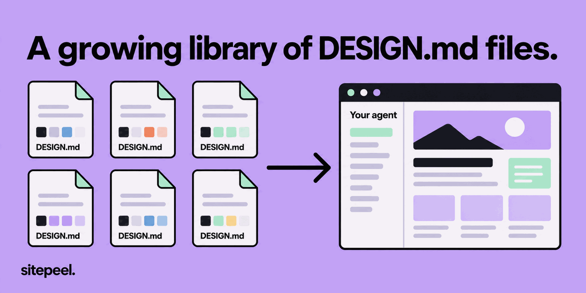
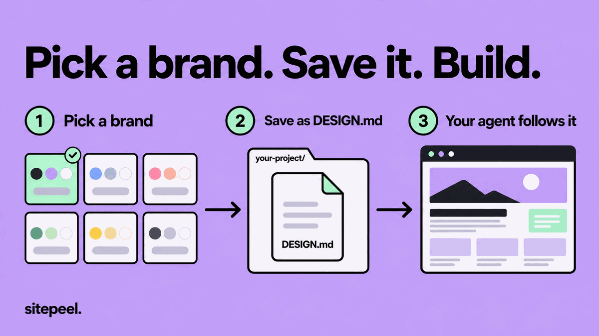
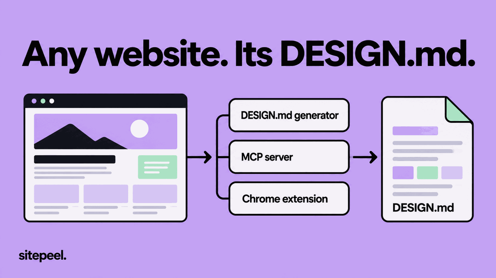
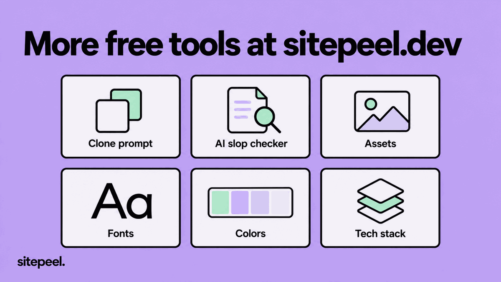

<!-- Generated by scripts/sync.mjs from the Sitepeel library. Edit the script, not this file. -->

<p align="center"><a href="https://sitepeel.dev/design-md/examples/"></a></p>

<h1 align="center">DESIGN.md library</h1>

<p align="center">A growing library of free DESIGN.md files for AI coding agents.<br>319 websites so far, measured by <a href="https://sitepeel.dev">Sitepeel</a> and updated every day.</p>

<p align="center">
  <a href="https://sitepeel.dev/design-md/"><b>Generate a DESIGN.md</b></a> ·
  <a href="https://sitepeel.dev/design-md/examples/">Browse with style guides</a> ·
  <a href="https://sitepeel.dev/mcp/">MCP server</a> ·
  <a href="https://sitepeel.dev/extension/">Chrome extension</a> ·
  <a href="https://sitepeel.dev">sitepeel.dev</a>
</p>

<p align="center">
  <a href="#all-brands"></a>
  <a href="https://github.com/Josephbadigar/design-md/actions/workflows/sync.yml"></a>
  <a href="LICENSE"></a>
</p>

DESIGN.md is a plain-text design system in the format Google published with Stitch. Colors, fonts, spacing and component tokens sit at the top of the file, with short rules underneath. AI coding agents such as Claude Code, Cursor, Codex and Stitch read it to build UI in a set style. This library has 319 of them so far, for sites like Stripe, Linear and Vercel, and it grows as people make new ones on [Sitepeel](https://sitepeel.dev). Each file is measured from the live site. You can browse the same library, with a style guide for every brand, at [sitepeel.dev/design-md/examples](https://sitepeel.dev/design-md/examples/).

<table>
<tr><td align="center" width="33%"><a href="design-md/stripe.com/"></a><br><a href="design-md/stripe.com/"><b>Stripe</b></a> · <a href="design-md/stripe.com/DESIGN.md">DESIGN.md</a></td><td align="center" width="33%"><a href="design-md/linear.app/"></a><br><a href="design-md/linear.app/"><b>Linear</b></a> · <a href="design-md/linear.app/DESIGN.md">DESIGN.md</a></td><td align="center" width="33%"><a href="design-md/vercel.com/"></a><br><a href="design-md/vercel.com/"><b>Vercel</b></a> · <a href="design-md/vercel.com/DESIGN.md">DESIGN.md</a></td></tr>
<tr><td align="center" width="33%"><a href="design-md/notion.com/"></a><br><a href="design-md/notion.com/"><b>Notion</b></a> · <a href="design-md/notion.com/DESIGN.md">DESIGN.md</a></td><td align="center" width="33%"><a href="design-md/figma.com/"></a><br><a href="design-md/figma.com/"><b>Figma</b></a> · <a href="design-md/figma.com/DESIGN.md">DESIGN.md</a></td><td align="center" width="33%"><a href="design-md/apple.com/"></a><br><a href="design-md/apple.com/"><b>Apple</b></a> · <a href="design-md/apple.com/DESIGN.md">DESIGN.md</a></td></tr>
<tr><td align="center" width="33%"><a href="design-md/anthropic.com/"></a><br><a href="design-md/anthropic.com/"><b>Anthropic</b></a> · <a href="design-md/anthropic.com/DESIGN.md">DESIGN.md</a></td><td align="center" width="33%"><a href="design-md/cursor.com/"></a><br><a href="design-md/cursor.com/"><b>Cursor</b></a> · <a href="design-md/cursor.com/DESIGN.md">DESIGN.md</a></td><td align="center" width="33%"><a href="design-md/supabase.com/"></a><br><a href="design-md/supabase.com/"><b>Supabase</b></a> · <a href="design-md/supabase.com/DESIGN.md">DESIGN.md</a></td></tr>
</table>

**Don't see your site?** [Generate its DESIGN.md](https://sitepeel.dev/design-md/) from any link in under a minute, free.

- [How to use](#how-to-use)
- [Generate a DESIGN.md for any site](#generate-a-designmd-for-any-site)
- [All brands](#all-brands): [AI](#ai) (26), [Developer tools](#developer-tools) (75), [UI and animation libraries](#ui-and-animation-libraries) (30), [SaaS and productivity](#saas-and-productivity) (53), [Fintech and payments](#fintech-and-payments) (32), [Marketing and analytics](#marketing-and-analytics) (17), [Design tools and site builders](#design-tools-and-site-builders) (36), [Inspiration](#inspiration) (14), [E-commerce and brands](#e-commerce-and-brands) (12), [Media and consumer apps](#media-and-consumer-apps) (14), [Security and privacy](#security-and-privacy) (4), [Agencies and studios](#agencies-and-studios) (6)
- [About Sitepeel](#about-sitepeel)
- [Credit and license](#credit-and-license)
- [FAQ](#faq)

## How to use



1. Pick a brand close to what you are building.
2. Save its DESIGN.md in your project's root folder.
3. Tell your agent to follow DESIGN.md for every UI change.

To fetch one from the terminal, for example Linear:

```sh
curl -o DESIGN.md https://raw.githubusercontent.com/Josephbadigar/design-md/main/design-md/linear.app/DESIGN.md
```

Swap `linear.app` for any folder name in the tables below.

## Generate a DESIGN.md for any site



The library grows every day, but not every site is here yet. Sitepeel gives you three ways to make the file yourself:

- The free [DESIGN.md generator](https://sitepeel.dev/design-md/). Paste a link and it measures the live page, with a visual style guide you can share.
- The free [MCP server](https://sitepeel.dev/mcp/), so your agent can call `get_design_md` and `search_design_library` on its own. Add it to Claude Code with:

  ```sh
  claude mcp add --transport http sitepeel https://sitepeel.dev/mcp
  ```

- The [Chrome extension](https://sitepeel.dev/extension/). It reads the page open in your browser, so it also works on pages behind a login.

## All brands

319 brands in 12 categories so far, with more added as the [library on sitepeel.dev](https://sitepeel.dev/design-md/examples/) grows. Colors are listed background first, then surfaces, text and the accent. Open a brand to see its screenshot. Scripts and agents can read the same list from [index.json](index.json).

### AI

26 brands.

| Brand | Theme | Fonts | Colors | Links |
| --- | --- | --- | --- | --- |
| [Anthropic](design-md/anthropic.com/)<br><sub>anthropic.com</sub> | Light | anthropicSans, anthropicSerif | <sub>#F5F4ED #FFFFFF #FAF9F5 #141413 #30302E</sub> | [DESIGN.md](design-md/anthropic.com/DESIGN.md), [style guide](https://sitepeel.dev/design-md/anthropic.com/) |
| [bolt.new](design-md/bolt.new/)<br><sub>bolt.new</sub> | Dark | Schibsted Grotesk, Silkscreen | <sub>#111114 #000000 #171719 #F9F6F9 #D6D5DE #2BA6FF</sub> | [DESIGN.md](design-md/bolt.new/DESIGN.md), [style guide](https://sitepeel.dev/design-md/bolt.new/) |
| [Cohere](design-md/cohere.com/)<br><sub>cohere.com</sub> | Light | CohereText, Unica77 Cohere Web | <sub>#FFFFFF #F0EEE9 #000000 #17171C #00AA28</sub> | [DESIGN.md](design-md/cohere.com/DESIGN.md), [style guide](https://sitepeel.dev/design-md/cohere.com/) |
| [Cursor](design-md/cursor.com/)<br><sub>cursor.com</sub> | Dark | CursorGothic, EB Garamond | <sub>#14120B #201E18 #1B1913 #EDECEC #969592 #F54E00</sub> | [DESIGN.md](design-md/cursor.com/DESIGN.md), [style guide](https://sitepeel.dev/design-md/cursor.com/) |
| [DeepL](design-md/deepl.com/)<br><sub>deepl.com</sub> | Light | robotoLatin | <sub>#FFFFFF #DEFDEE #F8F8F8 #191919 #091A2B #0F2B46</sub> | [DESIGN.md](design-md/deepl.com/DESIGN.md), [style guide](https://sitepeel.dev/design-md/deepl.com/) |
| [ElevenLabs](design-md/elevenlabs.io/)<br><sub>elevenlabs.io</sub> | Light | Waldenburg, Inter | <sub>#F5F3F1 #FDFCFC #EFEFEF #000000 #777169 #F41A2F</sub> | [DESIGN.md](design-md/elevenlabs.io/DESIGN.md), [style guide](https://sitepeel.dev/design-md/elevenlabs.io/) |
| [Gamma](design-md/gamma.app/)<br><sub>gamma.app</sub> | Light | ESBuild, PPMori | <sub>#FFFFFF #66666B #0540AD #002253 #0740DF</sub> | [DESIGN.md](design-md/gamma.app/DESIGN.md), [style guide](https://sitepeel.dev/design-md/gamma.app/) |
| [Granola](design-md/granola.ai/)<br><sub>granola.ai</sub> | Light | quadrant, melange | <sub>#FFFFFF #EAEBE5 #F7F7F2 #292929 #72726E #B2C248</sub> | [DESIGN.md](design-md/granola.ai/DESIGN.md), [style guide](https://sitepeel.dev/design-md/granola.ai/) |
| [HeyGen](design-md/heygen.com/)<br><sub>heygen.com</sub> | Light | ABC Solar Display, TT Norms Pro | <sub>#FFFFFF #000000 #171717 #00C3FF #F3A6FF #3CE6AC</sub> | [DESIGN.md](design-md/heygen.com/DESIGN.md), [style guide](https://sitepeel.dev/design-md/heygen.com/) |
| [Hugging Face](design-md/huggingface.co/)<br><sub>huggingface.co</sub> | Dark | Source Sans Pro, IBM Plex Mono | <sub>#0B0F19 #101828 #E5E7EB #D1D5DC #2B7FFF</sub> | [DESIGN.md](design-md/huggingface.co/DESIGN.md), [style guide](https://sitepeel.dev/design-md/huggingface.co/) |
| [Krea](design-md/krea.ai/)<br><sub>krea.ai</sub> | Dark | Suisse Intl | <sub>#0B0F15 #000000 #0D1530 #FFFFFF #A3A3A3 #262626</sub> | [DESIGN.md](design-md/krea.ai/DESIGN.md), [style guide](https://sitepeel.dev/design-md/krea.ai/) |
| [Lovable](design-md/lovable.dev/)<br><sub>lovable.dev</sub> | Light | Camera Plain Variable | <sub>#FCFBF8 #F5F5F5 #FFFFFF #636363 #1C1C1C #1E1E1E</sub> | [DESIGN.md](design-md/lovable.dev/DESIGN.md), [style guide](https://sitepeel.dev/design-md/lovable.dev/) |
| [Luma](design-md/lumalabs.ai/)<br><sub>lumalabs.ai</sub> | Dark | graphik | <sub>#000000 #FFFFFF #B3B3B3 #D97757</sub> | [DESIGN.md](design-md/lumalabs.ai/DESIGN.md), [style guide](https://sitepeel.dev/design-md/lumalabs.ai/) |
| [Mistral](design-md/mistral.ai/)<br><sub>mistral.ai</sub> | Dark | ALTMistral, Inter | <sub>#101013 #1A1A1E #FAFAF4 #A1A1AA #FFAF01 #FF8204</sub> | [DESIGN.md](design-md/mistral.ai/DESIGN.md), [style guide](https://sitepeel.dev/design-md/mistral.ai/) |
| [Modal](design-md/modal.com/)<br><sub>modal.com</sub> | Dark | ABC Diatype, DM Mono | <sub>#040804 #181818 #10120F #A8ABA6 #E3E5E1 #7FEE64</sub> | [DESIGN.md](design-md/modal.com/DESIGN.md), [style guide](https://sitepeel.dev/design-md/modal.com/) |
| [OpenAI](design-md/openai.com/)<br><sub>openai.com</sub> | Light | OpenAI Sans | <sub>#FFFFFF #000000 #666666 #AB4F7A #6BC67F #653218</sub> | [DESIGN.md](design-md/openai.com/DESIGN.md), [style guide](https://sitepeel.dev/design-md/openai.com/) |
| [OpenRouter](design-md/openrouter.ai/)<br><sub>openrouter.ai</sub> | Light | gordita, Plus Jakarta Sans | <sub>#FCFCFE #FFFFFF #03080A #505456 #7624F4 #E27625</sub> | [DESIGN.md](design-md/openrouter.ai/DESIGN.md), [style guide](https://sitepeel.dev/design-md/openrouter.ai/) |
| [Perplexity AI](design-md/perplexity.ai/)<br><sub>perplexity.ai</sub> | Dark | pplxSans | <sub>#15191D #1A1E21 #081F22 #DADFE3 #959A9E #016A71</sub> | [DESIGN.md](design-md/perplexity.ai/DESIGN.md), [style guide](https://sitepeel.dev/design-md/perplexity.ai/) |
| [Pinecone](design-md/pinecone.io/)<br><sub>pinecone.io</sub> | Light | gtPlanar, JetBrains Mono | <sub>#FBFBFC #FFFFFF #1C1917 #57534E #002BFF #3D11A0</sub> | [DESIGN.md](design-md/pinecone.io/DESIGN.md), [style guide](https://sitepeel.dev/design-md/pinecone.io/) |
| [Replicate](design-md/replicate.com/)<br><sub>replicate.com</sub> | Light | rb-freigeist-neue, basier-square | <sub>#FFFFFF #FEFCE9 #FFFCFC #202020 #24292E #000000</sub> | [DESIGN.md](design-md/replicate.com/DESIGN.md), [style guide](https://sitepeel.dev/design-md/replicate.com/) |
| [Replit](design-md/replit.com/)<br><sub>replit.com</sub> | Light | Replit Diatype, Replit Diatype Mono | <sub>#FAF6F1 #F3F3F1 #F7F7F6 #4B5563 #37383C #FF3C00</sub> | [DESIGN.md](design-md/replit.com/DESIGN.md), [style guide](https://sitepeel.dev/design-md/replit.com/) |
| [Runway](design-md/runwayml.com/)<br><sub>runwayml.com</sub> | Light | abcNormal | <sub>#FFFFFF #EEF1F5 #F7F7F7 #404040 #1A1A1A #2B22FA</sub> | [DESIGN.md](design-md/runwayml.com/DESIGN.md), [style guide](https://sitepeel.dev/design-md/runwayml.com/) |
| [Stability AI](design-md/stability.ai/)<br><sub>stability.ai</sub> | Dark | Archivo, Figtree | <sub>#1E1E1E #000000 #FFFFFF #E5E7E6 #A381FF</sub> | [DESIGN.md](design-md/stability.ai/DESIGN.md), [style guide](https://sitepeel.dev/design-md/stability.ai/) |
| [Suno](design-md/suno.com/)<br><sub>suno.com</sub> | Dark | Neue Montreal, Editorial New | <sub>#101012 #000000 #F7F4EF #FCFBF9 #02D95C #1F8BFF</sub> | [DESIGN.md](design-md/suno.com/DESIGN.md), [style guide](https://sitepeel.dev/design-md/suno.com/) |
| [Synthesia](design-md/synthesia.io/)<br><sub>synthesia.io</sub> | Light | Basiersquare Webfont | <sub>#FFFFFF #F7F7F7 #363636 #68686A #771A0D #3E57DA</sub> | [DESIGN.md](design-md/synthesia.io/DESIGN.md), [style guide](https://sitepeel.dev/design-md/synthesia.io/) |
| [v0](design-md/v0.app/)<br><sub>v0.app</sub> | Light | GeistSans, Inter | <sub>#FAFAFA #F2F2F2 #FFFFFF #171717 #4D4D4D</sub> | [DESIGN.md](design-md/v0.app/DESIGN.md), [style guide](https://sitepeel.dev/design-md/v0.app/) |

### Developer tools

75 brands.

| Brand | Theme | Fonts | Colors | Links |
| --- | --- | --- | --- | --- |
| [Astro](design-md/astro.build/)<br><sub>astro.build</sub> | Dark | Obviously | <sub>#060913 #0C0F19 #0D0F14 #F2F6FA #BFC1C9 #1A1367</sub> | [DESIGN.md](design-md/astro.build/DESIGN.md), [style guide](https://sitepeel.dev/design-md/astro.build/) |
| [Auth0](design-md/auth0.com/)<br><sub>auth0.com</sub> | Dark | Aeonik, Aeonik Mono | <sub>#20003A #000000 #120021 #FFFFFF #E5E5E5 #BCBAFF</sub> | [DESIGN.md](design-md/auth0.com/DESIGN.md), [style guide](https://sitepeel.dev/design-md/auth0.com/) |
| [AWS](design-md/aws.amazon.com/)<br><sub>aws.amazon.com</sub> | Light | Amazon Ember Display, Arial | <sub>#DEDEE3 #F3F3F7 #CCCCD1 #161D26 #232B37 #0972D3</sub> | [DESIGN.md](design-md/aws.amazon.com/DESIGN.md), [style guide](https://sitepeel.dev/design-md/aws.amazon.com/) |
| [Better Stack](design-md/betterstack.com/)<br><sub>betterstack.com</sub> | Dark | Helvetica Now Display, Helvetica Now Text | <sub>#0B0C14 #171926 #0F101A #939DB8 #C9D3EE #5B63D3</sub> | [DESIGN.md](design-md/betterstack.com/DESIGN.md), [style guide](https://sitepeel.dev/design-md/betterstack.com/) |
| [Bun](design-md/bun.sh/)<br><sub>bun.sh</sub> | Light | Archivo | <sub>#FFFFFF #F6F6F6 #0A0A0A #525252 #0C0C0C #D60066</sub> | [DESIGN.md](design-md/bun.sh/DESIGN.md), [style guide](https://sitepeel.dev/design-md/bun.sh/) |
| [Clerk](design-md/clerk.com/)<br><sub>clerk.com</sub> | Light | geistNumbers | <sub>#FFFFFF #EEEEF0 #F7F7F8 #131316 #5E5F6E #42434D</sub> | [DESIGN.md](design-md/clerk.com/DESIGN.md), [style guide](https://sitepeel.dev/design-md/clerk.com/) |
| [Cloudflare](design-md/cloudflare.com/)<br><sub>cloudflare.com</sub> | Light | STK Bureau Sans | <sub>#FF5E1F #1F1F1F #FFFBF5 #FF5F08 #FF9910</sub> | [DESIGN.md](design-md/cloudflare.com/DESIGN.md), [style guide](https://sitepeel.dev/design-md/cloudflare.com/) |
| [Convex](design-md/convex.dev/)<br><sub>convex.dev</sub> | Dark | neue-haas-grotesk-display, gtAmerica | <sub>#281D1D #141414 #292929 #FFFFFF #FAF4E9 #38383A</sub> | [DESIGN.md](design-md/convex.dev/DESIGN.md), [style guide](https://sitepeel.dev/design-md/convex.dev/) |
| [Cypress](design-md/cypress.io/)<br><sub>cypress.io</sub> | Light | Poppins, Roboto | <sub>#FFFFFF #5A5F7A #003131 #007780 #4956E3 #00595D</sub> | [DESIGN.md](design-md/cypress.io/DESIGN.md), [style guide](https://sitepeel.dev/design-md/cypress.io/) |
| [Databricks](design-md/databricks.com/)<br><sub>databricks.com</sub> | Dark | DM Sans, DM Mono | <sub>#0B2026 #1B3139 #FFFFFF #C4CCD6 #EB1600 #016BC1</sub> | [DESIGN.md](design-md/databricks.com/DESIGN.md), [style guide](https://sitepeel.dev/design-md/databricks.com/) |
| [Datadog](design-md/datadoghq.com/)<br><sub>datadoghq.com</sub> | Light | NationalWeb | <sub>#FFFFFF #F6F6F6 #212529 #555555 #632CA6 #9EC5FE</sub> | [DESIGN.md](design-md/datadoghq.com/DESIGN.md), [style guide](https://sitepeel.dev/design-md/datadoghq.com/) |
| [Deno](design-md/deno.com/)<br><sub>deno.com</sub> | Dark | Inter, Menlo | <sub>#001319 #25272B #121417 #868789 #9EA0A5 #F5F5F5</sub> | [DESIGN.md](design-md/deno.com/DESIGN.md), [style guide](https://sitepeel.dev/design-md/deno.com/) |
| [Django](design-md/djangoproject.com/)<br><sub>djangoproject.com</sub> | Light | Roboto | <sub>#FFFFFF #F8F8F8 #F1FFF7 #0C3C26 #859D94 #0C4B33</sub> | [DESIGN.md](design-md/djangoproject.com/DESIGN.md), [style guide](https://sitepeel.dev/design-md/djangoproject.com/) |
| [Docker](design-md/docker.com/)<br><sub>docker.com</sub> | Light | Repro, Inter | <sub>#F9FAFB #D6DCE6 #FFFFFF #2C333F #8A93AB #2560FF</sub> | [DESIGN.md](design-md/docker.com/DESIGN.md), [style guide](https://sitepeel.dev/design-md/docker.com/) |
| [Expo](design-md/expo.dev/)<br><sub>expo.dev</sub> | Light | Inter, JetBrains Mono | <sub>#FFFFFF #F0F0F3 #FCFCFD #1C2024 #60646C #000000</sub> | [DESIGN.md](design-md/expo.dev/DESIGN.md), [style guide](https://sitepeel.dev/design-md/expo.dev/) |
| [Firebase](design-md/firebase.google.com/)<br><sub>firebase.google.com</sub> | Dark | Google Sans, Material Icons | <sub>#1E1E1E #FFFFFF #F57C00 #FF9100 #1765CC</sub> | [DESIGN.md](design-md/firebase.google.com/DESIGN.md), [style guide](https://sitepeel.dev/design-md/firebase.google.com/) |
| [Flutter](design-md/flutter.dev/)<br><sub>flutter.dev</sub> | Dark | Google Sans Flex | <sub>#1A68D3 #FFFFFF #000000 #14C2AD</sub> | [DESIGN.md](design-md/flutter.dev/DESIGN.md), [style guide](https://sitepeel.dev/design-md/flutter.dev/) |
| [Fly.io](design-md/fly.io/)<br><sub>fly.io</sub> | Light | Mackinac, Fricolage Grotesque | <sub>#F4F6EB #FFFFFF #5B5077 #686082 #7C3AED #CAE3FD</sub> | [DESIGN.md](design-md/fly.io/DESIGN.md), [style guide](https://sitepeel.dev/design-md/fly.io/) |
| [GitHub](design-md/github.com/)<br><sub>github.com</sub> | Light | Mona Sans, Mona Sans VF | <sub>#FFFFFF #F2F5F3 #F9FBF9 #000000 #58635B #08872B</sub> | [DESIGN.md](design-md/github.com/DESIGN.md), [style guide](https://sitepeel.dev/design-md/github.com/) |
| [GitLab](design-md/gitlab.com/)<br><sub>gitlab.com</sub> | Dark | GitLab Sans, GitLab Mono | <sub>#171321 #FFFFFF #F7F7F5 #E24329 #FC6D26</sub> | [DESIGN.md](design-md/gitlab.com/DESIGN.md), [style guide](https://sitepeel.dev/design-md/gitlab.com/) |
| [Go](design-md/go.dev/)<br><sub>go.dev</sub> | Dark | Roboto | <sub>#007D9C #FFFFFF #202224 #FDDD00 #FFED89 #00769C</sub> | [DESIGN.md](design-md/go.dev/DESIGN.md), [style guide](https://sitepeel.dev/design-md/go.dev/) |
| [Godot](design-md/godotengine.org/)<br><sub>godotengine.org</sub> | Dark | Montserrat | <sub>#333F67 #FFFFFF #F5F5F7 #F57389 #1F3C5E #3E8ECC</sub> | [DESIGN.md](design-md/godotengine.org/DESIGN.md), [style guide](https://sitepeel.dev/design-md/godotengine.org/) |
| [Google Cloud](design-md/cloud.google.com/)<br><sub>cloud.google.com</sub> | Light | Google Sans, Roboto | <sub>#FFFFFF #F8F9FC #5F6368 #212226 #D3E3FD #2051DA</sub> | [DESIGN.md](design-md/cloud.google.com/DESIGN.md), [style guide](https://sitepeel.dev/design-md/cloud.google.com/) |
| [Grafana Labs](design-md/grafana.com/)<br><sub>grafana.com</sub> | Light | Poppins, Inter | <sub>#F4F4F6 #F9F9FA #EAF0FF #000000 #2E2E38 #1B55F5</sub> | [DESIGN.md](design-md/grafana.com/DESIGN.md), [style guide](https://sitepeel.dev/design-md/grafana.com/) |
| [Heroku](design-md/heroku.com/)<br><sub>heroku.com</sub> | Light | Avant Garde, Salesforce Sans | <sub>#FFFFFF #EEF1F6 #F9F9FB #181818 #240643 #0176D3</sub> | [DESIGN.md](design-md/heroku.com/DESIGN.md), [style guide](https://sitepeel.dev/design-md/heroku.com/) |
| [Homebrew](design-md/brew.sh/)<br><sub>brew.sh</sub> | Dark | system fonts | <sub>#2E2A24 #FFFFFF #999999 #E2A843 #9C7645 #008080</sub> | [DESIGN.md](design-md/brew.sh/DESIGN.md), [style guide](https://sitepeel.dev/design-md/brew.sh/) |
| [incident.io](design-md/incident.io/)<br><sub>incident.io</sub> | Light | STKBureauSerif, STKBureauSans | <sub>#FFFFFF #F3F3F4 #F8F5F0 #161618 #111827 #F25533</sub> | [DESIGN.md](design-md/incident.io/DESIGN.md), [style guide](https://sitepeel.dev/design-md/incident.io/) |
| [Jenkins](design-md/jenkins.io/)<br><sub>jenkins.io</sub> | Light | georgia | <sub>#FFFFFF #000C1A #006CF6 #9EC5FE #052C65</sub> | [DESIGN.md](design-md/jenkins.io/DESIGN.md), [style guide](https://sitepeel.dev/design-md/jenkins.io/) |
| [JetBrains](design-md/jetbrains.com/)<br><sub>jetbrains.com</sub> | Dark | JetBrains Sans | <sub>#000000 #303033 #19191C #FFFFFF #B3B3B3 #6B57FF</sub> | [DESIGN.md](design-md/jetbrains.com/DESIGN.md), [style guide](https://sitepeel.dev/design-md/jetbrains.com/) |
| [Laravel](design-md/laravel.com/)<br><sub>laravel.com</sub> | Light | InstrumentSans, IBM Plex Mono | <sub>#FFFFFF #F5F5F5 #FAFAFA #737373 #11181C #F53003</sub> | [DESIGN.md](design-md/laravel.com/DESIGN.md), [style guide](https://sitepeel.dev/design-md/laravel.com/) |
| [Liveblocks](design-md/liveblocks.io/)<br><sub>liveblocks.io</sub> | Dark | suisse, JetBrains Mono | <sub>#000000 #FFFFFF #B7B4B4 #D165EC #88BEF2 #EFD26C</sub> | [DESIGN.md](design-md/liveblocks.io/DESIGN.md), [style guide](https://sitepeel.dev/design-md/liveblocks.io/) |
| [Mapbox](design-md/mapbox.com/)<br><sub>mapbox.com</sub> | Light | Cera pro | <sub>#FFFFFF #F7F9FC #333943 #8B949E #007AFC #4C8DFF</sub> | [DESIGN.md](design-md/mapbox.com/DESIGN.md), [style guide](https://sitepeel.dev/design-md/mapbox.com/) |
| [Microsoft Azure](design-md/azure.microsoft.com/)<br><sub>azure.microsoft.com</sub> | Dark | Segoe UI Variable Display, Segoe UI Variable Text | <sub>#002948 #FFFFFF #F4FAFD #0078D4 #B3DAF0 #05037B</sub> | [DESIGN.md](design-md/azure.microsoft.com/DESIGN.md), [style guide](https://sitepeel.dev/design-md/azure.microsoft.com/) |
| [Mintlify](design-md/mintlify.com/)<br><sub>mintlify.com</sub> | Light | arizonaFlare, inter | <sub>#FFFFFF #FAF8F5 #FEFDFB #08090A #121715 #0C8C5E</sub> | [DESIGN.md](design-md/mintlify.com/DESIGN.md), [style guide](https://sitepeel.dev/design-md/mintlify.com/) |
| [MongoDB](design-md/mongodb.com/)<br><sub>mongodb.com</sub> | Dark | Sohne Condensed, Sohne | <sub>#061621 #14242F #FAFBFC #E7EEEC #00ED64 #00684A</sub> | [DESIGN.md](design-md/mongodb.com/DESIGN.md), [style guide](https://sitepeel.dev/design-md/mongodb.com/) |
| [Mux](design-md/mux.com/)<br><sub>mux.com</sub> | Light | Rotonto, Aeonik | <sub>#E2E4DD #FFFFFF #D0D2C8 #000000 #FF6100 #FA50B5</sub> | [DESIGN.md](design-md/mux.com/DESIGN.md), [style guide](https://sitepeel.dev/design-md/mux.com/) |
| [Neon](design-md/neon.tech/)<br><sub>neon.tech</sub> | Dark | Inter, GeistMono | <sub>#000000 #151617 #111315 #FFFFFF #C9CBCF #34D59A</sub> | [DESIGN.md](design-md/neon.tech/DESIGN.md), [style guide](https://sitepeel.dev/design-md/neon.tech/) |
| [Netlify](design-md/netlify.com/)<br><sub>netlify.com</sub> | Dark | Figtree, Instrument Sans | <sub>#12181F #181A1C #FFFFFF #DEFFFE #32E6E2 #014847</sub> | [DESIGN.md](design-md/netlify.com/DESIGN.md), [style guide](https://sitepeel.dev/design-md/netlify.com/) |
| [Next.js](design-md/nextjs.org/)<br><sub>nextjs.org</sub> | Light | GeistSans | <sub>#FAFAFA #E6E6E6 #FFFFFF #171717 #4D4D4D #0057FF</sub> | [DESIGN.md](design-md/nextjs.org/DESIGN.md), [style guide](https://sitepeel.dev/design-md/nextjs.org/) |
| [NixOS](design-md/nixos.org/)<br><sub>nixos.org</sub> | Dark | Route159, Roboto Flex Variable | <sub>#3B5487 #FFFFFF #EEEEEE #28395F #4D6FB7 #A4D5F7</sub> | [DESIGN.md](design-md/nixos.org/DESIGN.md), [style guide](https://sitepeel.dev/design-md/nixos.org/) |
| [Node.js](design-md/nodejs.org/)<br><sub>nodejs.org</sub> | Light | OPEN SANS, SFMono-Regular | <sub>#FFFFFF #E9F4FA #F6F7F9 #1F2328 #2C3437 #417E38</sub> | [DESIGN.md](design-md/nodejs.org/DESIGN.md), [style guide](https://sitepeel.dev/design-md/nodejs.org/) |
| [Nuxt](design-md/nuxt.com/)<br><sub>nuxt.com</sub> | Dark | Outfit, Inter | <sub>#0A0A0A #262626 #171717 #E5E5E5 #BABED8 #00DC82</sub> | [DESIGN.md](design-md/nuxt.com/DESIGN.md), [style guide](https://sitepeel.dev/design-md/nuxt.com/) |
| [Payload](design-md/payloadcms.com/)<br><sub>payloadcms.com</sub> | Light | untitledSans, GeistMono | <sub>#FFFFFF #000000 #808080</sub> | [DESIGN.md](design-md/payloadcms.com/DESIGN.md), [style guide](https://sitepeel.dev/design-md/payloadcms.com/) |
| [PHP](design-md/php.net/)<br><sub>php.net</sub> | Dark | Fira Sans | <sub>#333333 #CCCCCC #DBE1FF #4F5B93 #90A0D0</sub> | [DESIGN.md](design-md/php.net/DESIGN.md), [style guide](https://sitepeel.dev/design-md/php.net/) |
| [PlanetScale](design-md/planetscale.com/)<br><sub>planetscale.com</sub> | Light | ui-monospace | <sub>#FAFAFA #414141 #737373 #FBCA00 #F35815 #0B6EC5</sub> | [DESIGN.md](design-md/planetscale.com/DESIGN.md), [style guide](https://sitepeel.dev/design-md/planetscale.com/) |
| [Poimandres](design-md/pmnd.rs/)<br><sub>pmnd.rs</sub> | Light | Inter | <sub>#FFFFFF #555555 #E8756A</sub> | [DESIGN.md](design-md/pmnd.rs/DESIGN.md), [style guide](https://sitepeel.dev/design-md/pmnd.rs/) |
| [Postman](design-md/postman.com/)<br><sub>postman.com</sub> | Light | gtStandard | <sub>#FF6C37 #212121 #FFFFFF #E0531F #FF8A5C #0265D2</sub> | [DESIGN.md](design-md/postman.com/DESIGN.md), [style guide](https://sitepeel.dev/design-md/postman.com/) |
| [Prisma](design-md/prisma.io/)<br><sub>prisma.io</sub> | Light | Sora, Inter | <sub>#FFFFFF #DCFDFF #EEFFFF #3A3B3C #646567 #000000</sub> | [DESIGN.md](design-md/prisma.io/DESIGN.md), [style guide](https://sitepeel.dev/design-md/prisma.io/) |
| [Python.org](design-md/python.org/)<br><sub>python.org</sub> | Light | Flux-Regular, SourceSansProBold | <sub>#F9F9F9 #E6E8EA #FFFFFF #444444 #4D4D4D #2B5B84</sub> | [DESIGN.md](design-md/python.org/DESIGN.md), [style guide](https://sitepeel.dev/design-md/python.org/) |
| [Railway](design-md/railway.com/)<br><sub>railway.com</sub> | Dark | IBM Plex Serif, Inter | <sub>#13111C #291839 #1C1A28 #FFFFFF #F7F7F8 #553F83</sub> | [DESIGN.md](design-md/railway.com/DESIGN.md), [style guide](https://sitepeel.dev/design-md/railway.com/) |
| [React](design-md/react.dev/)<br><sub>react.dev</sub> | Light | Optimistic Display, Optimistic Text | <sub>#FFFFFF #F6F7F9 #24292E #404756 #087EA4 #005CC5</sub> | [DESIGN.md](design-md/react.dev/DESIGN.md), [style guide](https://sitepeel.dev/design-md/react.dev/) |
| [React Native](design-md/reactnative.dev/)<br><sub>reactnative.dev</sub> | Light | Optimistic Display | <sub>#FFFFFF #1C1E21 #404756 #087EA4 #357DA1 #72A1ED</sub> | [DESIGN.md](design-md/reactnative.dev/DESIGN.md), [style guide](https://sitepeel.dev/design-md/reactnative.dev/) |
| [Redis](design-md/redis.io/)<br><sub>redis.io</sub> | Dark | primaryFont, Space Grotesk | <sub>#091A23 #351D22 #0D212C #FFFFFF #B9C2C6 #FF4438</sub> | [DESIGN.md](design-md/redis.io/DESIGN.md), [style guide](https://sitepeel.dev/design-md/redis.io/) |
| [Remix](design-md/remix.run/)<br><sub>remix.run</sub> | Dark | Inter, JetBrains Mono | <sub>#000000 #1E2226 #DEE2E6 #C2C2C2 #FE4754 #2DACF9</sub> | [DESIGN.md](design-md/remix.run/DESIGN.md), [style guide](https://sitepeel.dev/design-md/remix.run/) |
| [Render](design-md/render.com/)<br><sub>render.com</sub> | Dark | Roobert, PPNeueMontreal | <sub>#0D0D0D #FFFFFF #E3E3E3 #1C0037 #D1B8FF #8A05FF</sub> | [DESIGN.md](design-md/render.com/DESIGN.md), [style guide](https://sitepeel.dev/design-md/render.com/) |
| [Resend](design-md/resend.com/)<br><sub>resend.com</sub> | Dark | domaine, aBCFavorit | <sub>#000000 #0B0E14 #F0F0F0 #ABAFB4 #9281F7</sub> | [DESIGN.md](design-md/resend.com/DESIGN.md), [style guide](https://sitepeel.dev/design-md/resend.com/) |
| [Retool](design-md/retool.com/)<br><sub>retool.com</sub> | Dark | saansFont, pxGroteskFont | <sub>#151515 #242424 #E9EBDF #CBCCC4 #ECA438 #EF4444</sub> | [DESIGN.md](design-md/retool.com/DESIGN.md), [style guide](https://sitepeel.dev/design-md/retool.com/) |
| [Rust](design-md/rust-lang.org/)<br><sub>rust-lang.org</sub> | Dark | Alfa Slab One, Fira Sans | <sub>#0B7261 #000000 #2A3439 #2E2459 #4299BF</sub> | [DESIGN.md](design-md/rust-lang.org/DESIGN.md), [style guide](https://sitepeel.dev/design-md/rust-lang.org/) |
| [Sanity](design-md/sanity.io/)<br><sub>sanity.io</sub> | Dark | Waldenburg, IBM Plex Mono | <sub>#0B0B0B #212121 #FFFFFF #E1E4E8 #FF4100 #9ECBFF</sub> | [DESIGN.md](design-md/sanity.io/DESIGN.md), [style guide](https://sitepeel.dev/design-md/sanity.io/) |
| [Sentry](design-md/sentry.io/)<br><sub>sentry.io</sub> | Dark | Dammit Sans, Rubik | <sub>#1F1633 #FFFFFF #6A5FC1 #FD44B0 #C2EF4E</sub> | [DESIGN.md](design-md/sentry.io/DESIGN.md), [style guide](https://sitepeel.dev/design-md/sentry.io/) |
| [Stack Overflow](design-md/stackoverflow.com/)<br><sub>stackoverflow.com</sub> | Light | system fonts | <sub>#FFFFFF #F1F2F3 #EDF5FD #0C0D0E #3B4045 #1B75D0</sub> | [DESIGN.md](design-md/stackoverflow.com/DESIGN.md), [style guide](https://sitepeel.dev/design-md/stackoverflow.com/) |
| [Streamlit](design-md/streamlit.io/)<br><sub>streamlit.io</sub> | Light | Inter, Helvetica | <sub>#FFFFFF #F0F2F6 #FFFAE8 #262730 #697882 #FF4B4B</sub> | [DESIGN.md](design-md/streamlit.io/DESIGN.md), [style guide](https://sitepeel.dev/design-md/streamlit.io/) |
| [Sublime Text](design-md/sublimetext.com/)<br><sub>sublimetext.com</sub> | Light | Lato | <sub>#EEEEEE #CCCCCC #FFFFFF #555555 #666666 #3C78B4</sub> | [DESIGN.md](design-md/sublimetext.com/DESIGN.md), [style guide](https://sitepeel.dev/design-md/sublimetext.com/) |
| [Supabase](design-md/supabase.com/)<br><sub>supabase.com</sub> | Light | Manrope, Inter | <sub>#FDFDFD #FFFFFF #030303 #525252 #0E7E4E #3FCF8E</sub> | [DESIGN.md](design-md/supabase.com/DESIGN.md), [style guide](https://sitepeel.dev/design-md/supabase.com/) |
| [Svelte](design-md/svelte.dev/)<br><sub>svelte.dev</sub> | Light | DM Serif Display, Fira Sans | <sub>#FFFFFF #F2F2F2 #262626 #141414 #D43008</sub> | [DESIGN.md](design-md/svelte.dev/DESIGN.md), [style guide](https://sitepeel.dev/design-md/svelte.dev/) |
| [Swagger](design-md/swagger.io/)<br><sub>swagger.io</sub> | Light | DM Sans | <sub>#FFFFFF #212529 #173647 #1874FE #F56A00 #061C5A</sub> | [DESIGN.md](design-md/swagger.io/DESIGN.md), [style guide](https://sitepeel.dev/design-md/swagger.io/) |
| [Twilio](design-md/twilio.com/)<br><sub>twilio.com</sub> | Dark | Buffalo, Whitney SSm | <sub>#000D25 #0D122B #FFFFFF #565B73 #1866EE #DB132A</sub> | [DESIGN.md](design-md/twilio.com/DESIGN.md), [style guide](https://sitepeel.dev/design-md/twilio.com/) |
| [TypeScript](design-md/typescriptlang.org/)<br><sub>typescriptlang.org</sub> | Dark | Segoe UI Web (West European), JetBrains Mono | <sub>#3178C6 #000000 #FFFFFF #235A97 #098658 #F7CBA4</sub> | [DESIGN.md](design-md/typescriptlang.org/DESIGN.md), [style guide](https://sitepeel.dev/design-md/typescriptlang.org/) |
| [Vercel](design-md/vercel.com/)<br><sub>vercel.com</sub> | Light | GeistSans, Geist Mono | <sub>#FAFAFA #EBEBEB #FFFFFF #171717 #4D4D4D #BA1638</sub> | [DESIGN.md](design-md/vercel.com/DESIGN.md), [style guide](https://sitepeel.dev/design-md/vercel.com/) |
| [Visual Studio Code](design-md/code.visualstudio.com/)<br><sub>code.visualstudio.com</sub> | Light | system fonts | <sub>#F0F0F0 #FFFFFF #1B1B1D #242424 #0069CC #2F6FB8</sub> | [DESIGN.md](design-md/code.visualstudio.com/DESIGN.md), [style guide](https://sitepeel.dev/design-md/code.visualstudio.com/) |
| [Vite](design-md/vite.dev/)<br><sub>vite.dev</sub> | Dark | APK Protocol, Inter | <sub>#16171D #14121A #FFFFFF #BABABC #9AC8FF #B39AFF</sub> | [DESIGN.md](design-md/vite.dev/DESIGN.md), [style guide](https://sitepeel.dev/design-md/vite.dev/) |
| [Vue.js](design-md/vuejs.org/)<br><sub>vuejs.org</sub> | Light | Inter var experimental | <sub>#FFFFFF #F1F1F1 #F9F9F9 #213547 #476582 #33A06F</sub> | [DESIGN.md](design-md/vuejs.org/DESIGN.md), [style guide](https://sitepeel.dev/design-md/vuejs.org/) |
| [Warp](design-md/warp.dev/)<br><sub>warp.dev</sub> | Light | azeretSemiMono | <sub>#FBF9FE #F7F7F7 #FBFDFD #1A1522 #5D5964 #2A1EFF</sub> | [DESIGN.md](design-md/warp.dev/DESIGN.md), [style guide](https://sitepeel.dev/design-md/warp.dev/) |
| [WorkOS](design-md/workos.com/)<br><sub>workos.com</sub> | Light | Untitled Sans, IBM Plex Mono | <sub>#FFFFFF #F9F9FB #29363D #656B8A #6363F1 #23F0C3</sub> | [DESIGN.md](design-md/workos.com/DESIGN.md), [style guide](https://sitepeel.dev/design-md/workos.com/) |
| [Zed](design-md/zed.dev/)<br><sub>zed.dev</sub> | Light | plexSerif, writer | <sub>#EEE7E7 #E5E5E5 #EBEBEC #242529 #525252 #1348DC</sub> | [DESIGN.md](design-md/zed.dev/DESIGN.md), [style guide](https://sitepeel.dev/design-md/zed.dev/) |

### UI and animation libraries

30 brands.

| Brand | Theme | Fonts | Colors | Links |
| --- | --- | --- | --- | --- |
| [Aceternity UI](design-md/ui.aceternity.com/)<br><sub>ui.aceternity.com</sub> | Light | Local x2wexs | <sub>#FFFFFF #E5E5E5 #F5F5F5 #09090B #404040 #3074FE</sub> | [DESIGN.md](design-md/ui.aceternity.com/DESIGN.md), [style guide](https://sitepeel.dev/design-md/ui.aceternity.com/) |
| [Ant Design](design-md/ant.design/)<br><sub>ant.design</sub> | Light | AlibabaSans | <sub>#FFFFFF #E8F4FD #F0F3FA #1F1F1F #595959 #1677FF</sub> | [DESIGN.md](design-md/ant.design/DESIGN.md), [style guide](https://sitepeel.dev/design-md/ant.design/) |
| [Bootstrap](design-md/getbootstrap.com/)<br><sub>getbootstrap.com</sub> | Light | Geist | <sub>#FFFFFF #F6F7F8 #444B51 #5D666E #7740FF #A87700</sub> | [DESIGN.md](design-md/getbootstrap.com/DESIGN.md), [style guide](https://sitepeel.dev/design-md/getbootstrap.com/) |
| [Chakra UI](design-md/chakra-ui.com/)<br><sub>chakra-ui.com</sub> | Light | Wix Madefor Text | <sub>#FFFFFF #E4E4E7 #F4F4F5 #09090B #27272A #0D9488</sub> | [DESIGN.md](design-md/chakra-ui.com/DESIGN.md), [style guide](https://sitepeel.dev/design-md/chakra-ui.com/) |
| [CodeMirror](design-md/codemirror.net/)<br><sub>codemirror.net</sub> | Light | Merriweather, Source Sans Pro | <sub>#FFFFFF #000000 #777777 #066ADF #0000FF #EE4400</sub> | [DESIGN.md](design-md/codemirror.net/DESIGN.md), [style guide](https://sitepeel.dev/design-md/codemirror.net/) |
| [daisyUI](design-md/daisyui.com/)<br><sub>daisyui.com</sub> | Light | Outfit | <sub>#FFFFFF #F8F8F8 #18181B #5D5D5F #09090B #EC003F</sub> | [DESIGN.md](design-md/daisyui.com/DESIGN.md), [style guide](https://sitepeel.dev/design-md/daisyui.com/) |
| [Flowbite](design-md/flowbite.com/)<br><sub>flowbite.com</sub> | Light | Inter | <sub>#FFFFFF #F3F4F6 #F9FAFB #111827 #6B7280 #1A56DB</sub> | [DESIGN.md](design-md/flowbite.com/DESIGN.md), [style guide](https://sitepeel.dev/design-md/flowbite.com/) |
| [Fluent 2](design-md/fluent2.microsoft.design/)<br><sub>fluent2.microsoft.design</sub> | Light | Segoe UI | <sub>#EEEBF0 #F5F5F5 #F0F0F0 #242424 #424242 #D13438</sub> | [DESIGN.md](design-md/fluent2.microsoft.design/DESIGN.md), [style guide](https://sitepeel.dev/design-md/fluent2.microsoft.design/) |
| [Font Awesome](design-md/fontawesome.com/)<br><sub>fontawesome.com</sub> | Light | cera-round-pro | <sub>#FFFFFF #F0F1F3 #183153 #616D8A #FFD43B #418FDE</sub> | [DESIGN.md](design-md/fontawesome.com/DESIGN.md), [style guide](https://sitepeel.dev/design-md/fontawesome.com/) |
| [GSAP](design-md/gsap.com/)<br><sub>gsap.com</sub> | Dark | Mori | <sub>#0E100F #000000 #FFFCE1 #FEC5FB #9D95FF #FF8709</sub> | [DESIGN.md](design-md/gsap.com/DESIGN.md), [style guide](https://sitepeel.dev/design-md/gsap.com/) |
| [Heroicons](design-md/heroicons.com/)<br><sub>heroicons.com</sub> | Light | Inter var | <sub>#FFFFFF #F1F5F9 #F8FAFC #0F172A #64748B #A78BFA</sub> | [DESIGN.md](design-md/heroicons.com/DESIGN.md), [style guide](https://sitepeel.dev/design-md/heroicons.com/) |
| [HeroUI](design-md/heroui.com/)<br><sub>heroui.com</sub> | Light | Inter | <sub>#F5F5F5 #FCFCFC #F9F9F9 #18181B #71717A #0485F7</sub> | [DESIGN.md](design-md/heroui.com/DESIGN.md), [style guide](https://sitepeel.dev/design-md/heroui.com/) |
| [Highcharts](design-md/highcharts.com/)<br><sub>highcharts.com</sub> | Light | IBM Plex Sans, IBM Plex Sans Variable | <sub>#FFFFFF #F2F1F4 #F0F1FF #18171C #626BD0 #047857</sub> | [DESIGN.md](design-md/highcharts.com/DESIGN.md), [style guide](https://sitepeel.dev/design-md/highcharts.com/) |
| [Lucide](design-md/lucide.dev/)<br><sub>lucide.dev</sub> | Light | Inter, ui-monospace | <sub>#FFFFFF #EBEBEF #F6F6F7 #3C3C43 #67676C #F67373</sub> | [DESIGN.md](design-md/lucide.dev/DESIGN.md), [style guide](https://sitepeel.dev/design-md/lucide.dev/) |
| [Magic UI](design-md/magicui.design/)<br><sub>magicui.design</sub> | Light | Geist | <sub>#FFFFFF #0A0A0A #737373 #4F39F6 #00C950 #2B7FFF</sub> | [DESIGN.md](design-md/magicui.design/DESIGN.md), [style guide](https://sitepeel.dev/design-md/magicui.design/) |
| [Mantine](design-md/mantine.dev/)<br><sub>mantine.dev</sub> | Light | Outfit | <sub>#FFFFFF #F1F3F5 #F8F9FA #000000 #1F2328 #339AF0</sub> | [DESIGN.md](design-md/mantine.dev/DESIGN.md), [style guide](https://sitepeel.dev/design-md/mantine.dev/) |
| [Material Design](design-md/m3.material.io/)<br><sub>m3.material.io</sub> | Light | Google Sans, Google Sans Text | <sub>#F8F1F6 #DCDAF5 #4D4256 #6442D6</sub> | [DESIGN.md](design-md/m3.material.io/DESIGN.md), [style guide](https://sitepeel.dev/design-md/m3.material.io/) |
| [Motion](design-md/motion.dev/)<br><sub>motion.dev</sub> | Dark | TASA Orbiter | <sub>#080808 #0E1312 #000000 #EDEBE5 #979D97 #FBD509</sub> | [DESIGN.md](design-md/motion.dev/DESIGN.md), [style guide](https://sitepeel.dev/design-md/motion.dev/) |
| [MUI](design-md/mui.com/)<br><sub>mui.com</sub> | Light | General Sans, IBM Plex Sans | <sub>#FFFFFF #DFE2E7 #EBF5FF #1A1E23 #303741 #0073E6</sub> | [DESIGN.md](design-md/mui.com/DESIGN.md), [style guide](https://sitepeel.dev/design-md/mui.com/) |
| [Phosphor Icons](design-md/phosphoricons.com/)<br><sub>phosphoricons.com</sub> | Light | Manrope, Arial | <sub>#EEEAE3 #BCADAF #FFFFFF #656461 #C4E456 #A4B55B</sub> | [DESIGN.md](design-md/phosphoricons.com/DESIGN.md), [style guide](https://sitepeel.dev/design-md/phosphoricons.com/) |
| [Primer](design-md/primer.style/)<br><sub>primer.style</sub> | Light | Mona Sans, Mona Sans VF | <sub>#FFFFFF #F6F8FA #000000 #58635B #0377FF #08872B</sub> | [DESIGN.md](design-md/primer.style/DESIGN.md), [style guide](https://sitepeel.dev/design-md/primer.style/) |
| [Radix UI](design-md/radix-ui.com/)<br><sub>radix-ui.com</sub> | Light | adobeTextPro | <sub>#FFFFFF #1C2024 #60646C #3E63DD #CB1D63</sub> | [DESIGN.md](design-md/radix-ui.com/DESIGN.md), [style guide](https://sitepeel.dev/design-md/radix-ui.com/) |
| [React Bits](design-md/reactbits.dev/)<br><sub>reactbits.dev</sub> | Dark | Geist, ui-monospace | <sub>#120F17 #221E29 #0E0B13 #FFFFFF #F6F4F9 #F4F2F7</sub> | [DESIGN.md](design-md/reactbits.dev/DESIGN.md), [style guide](https://sitepeel.dev/design-md/reactbits.dev/) |
| [Salesforce Lightning Design System](design-md/lightningdesignsystem.com/)<br><sub>lightningdesignsystem.com</sub> | Light | AvantGardeForSalesforce, Inter | <sub>#FFFFFF #2E2E2E #444444 #3A49DA #011744 #A8CBFF</sub> | [DESIGN.md](design-md/lightningdesignsystem.com/DESIGN.md), [style guide](https://sitepeel.dev/design-md/lightningdesignsystem.com/) |
| [Semantic UI](design-md/semantic-ui.com/)<br><sub>semantic-ui.com</sub> | Light | Lato | <sub>#FFFFFF #E8E8E8 #F3F4F5 #212121 #666666 #1B1C1D</sub> | [DESIGN.md](design-md/semantic-ui.com/DESIGN.md), [style guide](https://sitepeel.dev/design-md/semantic-ui.com/) |
| [shadcn/ui](design-md/ui.shadcn.com/)<br><sub>ui.shadcn.com</sub> | Light | Geist | <sub>#FFFFFF #F5F5F5 #FAFAFA #0A0A0A #171717 #F0B100</sub> | [DESIGN.md](design-md/ui.shadcn.com/DESIGN.md), [style guide](https://sitepeel.dev/design-md/ui.shadcn.com/) |
| [Storybook](design-md/storybook.js.org/)<br><sub>storybook.js.org</sub> | Dark | Nunito Sans | <sub>#0D1026 #333333 #000000 #FFFFFF #94A3B8 #029CFD</sub> | [DESIGN.md](design-md/storybook.js.org/DESIGN.md), [style guide](https://sitepeel.dev/design-md/storybook.js.org/) |
| [Tailwind CSS](design-md/tailwindcss.com/)<br><sub>tailwindcss.com</sub> | Dark | inter, plexMono | <sub>#030712 #FFFFFF #CAD5E2 #00BCFF #FB64B6 #74D4FF</sub> | [DESIGN.md](design-md/tailwindcss.com/DESIGN.md), [style guide](https://sitepeel.dev/design-md/tailwindcss.com/) |
| [Tremor](design-md/tremor.so/)<br><sub>tremor.so</sub> | Light | GeistSans | <sub>#FFFFFF #EFF6FF #101828 #364153 #2B7FFF #E12AFB</sub> | [DESIGN.md](design-md/tremor.so/DESIGN.md), [style guide](https://sitepeel.dev/design-md/tremor.so/) |
| [Vuetify](design-md/vuetifyjs.com/)<br><sub>vuetifyjs.com</sub> | Light | Roboto | <sub>#FFFFFF #EEEEEE #666666 #212121 #2373C4 #E2777A</sub> | [DESIGN.md](design-md/vuetifyjs.com/DESIGN.md), [style guide](https://sitepeel.dev/design-md/vuetifyjs.com/) |

### SaaS and productivity

53 brands.

| Brand | Theme | Fonts | Colors | Links |
| --- | --- | --- | --- | --- |
| [37signals](design-md/37signals.com/)<br><sub>37signals.com</sub> | Light | Lab Grotesque | <sub>#F87917 #000000 #FFFFFF #F87918</sub> | [DESIGN.md](design-md/37signals.com/DESIGN.md), [style guide](https://sitepeel.dev/design-md/37signals.com/) |
| [Airtable](design-md/airtable.com/)<br><sub>airtable.com</sub> | Light | ATSeasonSans, SF Pro Text | <sub>#FFFFFF #E0DAFD #EEF0F4 #2E2F32 #1D1F25 #944D37</sub> | [DESIGN.md](design-md/airtable.com/DESIGN.md), [style guide](https://sitepeel.dev/design-md/airtable.com/) |
| [Amie](design-md/amie.so/)<br><sub>amie.so</sub> | Light | Inter | <sub>#FAFAFA #EBEBEB #FFFFFF #000000 #5C5C5C #11A8FF</sub> | [DESIGN.md](design-md/amie.so/DESIGN.md), [style guide](https://sitepeel.dev/design-md/amie.so/) |
| [Arc](design-md/arc.net/)<br><sub>arc.net</sub> | Dark | Exposure VAR, ABC Oracle | <sub>#0B0B0B #000000 #FFFFFF #7F7F7F #5B45E0 #C86B00</sub> | [DESIGN.md](design-md/arc.net/DESIGN.md), [style guide](https://sitepeel.dev/design-md/arc.net/) |
| [Asana](design-md/asana.com/)<br><sub>asana.com</sub> | Light | TWK Lausanne | <sub>#FFFFFF #F3F3F3 #FAFAFA #0D0D0D #3D3D3D #FF584A</sub> | [DESIGN.md](design-md/asana.com/DESIGN.md), [style guide](https://sitepeel.dev/design-md/asana.com/) |
| [Atlassian](design-md/atlassian.com/)<br><sub>atlassian.com</sub> | Light | Charlie Display, Charlie Text | <sub>#FFFFFF #F8F8F8 #292A2E #1C2B42 #1868DB #7EE2B8</sub> | [DESIGN.md](design-md/atlassian.com/DESIGN.md), [style guide](https://sitepeel.dev/design-md/atlassian.com/) |
| [Attio](design-md/attio.com/)<br><sub>attio.com</sub> | Light | interDisplay, inter | <sub>#FFFFFF #F4F5F6 #FAFAFB #1C1D1F #232529 #202124</sub> | [DESIGN.md](design-md/attio.com/DESIGN.md), [style guide](https://sitepeel.dev/design-md/attio.com/) |
| [Basecamp](design-md/basecamp.com/)<br><sub>basecamp.com</sub> | Light | Graphik | <sub>#FFF9F5 #FCF9E7 #FCF8F3 #29353C #6D767B #117AF3</sub> | [DESIGN.md](design-md/basecamp.com/DESIGN.md), [style guide](https://sitepeel.dev/design-md/basecamp.com/) |
| [Bear](design-md/bear.app/)<br><sub>bear.app</sub> | Light | bearsansheadline, bearsans | <sub>#FFFFFF #444444 #888888 #DD4C4F #456AA3</sub> | [DESIGN.md](design-md/bear.app/DESIGN.md), [style guide](https://sitepeel.dev/design-md/bear.app/) |
| [Cal.com](design-md/cal.com/)<br><sub>cal.com</sub> | Light | Cal Sans, Cal Sans UI Variable Light | <sub>#FFFFFF #F5F5F5 #111111 #242424 #0099FF</sub> | [DESIGN.md](design-md/cal.com/DESIGN.md), [style guide](https://sitepeel.dev/design-md/cal.com/) |
| [Calendly.com](design-md/calendly.com/)<br><sub>calendly.com</sub> | Light | Calendly Sans, Wulkan Text | <sub>#F5F3EE #FFFFFF #FCFBF8 #071A31 #3D464E #C3DFFE</sub> | [DESIGN.md](design-md/calendly.com/DESIGN.md), [style guide](https://sitepeel.dev/design-md/calendly.com/) |
| [Cisco](design-md/cisco.com/)<br><sub>cisco.com</sub> | Dark | Inter | <sub>#000000 #FFFFFF #536070 #058103 #124FC9 #02C8FF</sub> | [DESIGN.md](design-md/cisco.com/DESIGN.md), [style guide](https://sitepeel.dev/design-md/cisco.com/) |
| [ClickUp](design-md/clickup.com/)<br><sub>clickup.com</sub> | Light | Plus Jakarta Sans, Inter | <sub>#FFFFFF #FEEFF6 #E7F9F5 #646464 #8A8A94 #FFC53D</sub> | [DESIGN.md](design-md/clickup.com/DESIGN.md), [style guide](https://sitepeel.dev/design-md/clickup.com/) |
| [Coda](design-md/coda.io/)<br><sub>coda.io</sub> | Light | Calibre-R, Inter | <sub>#FFFFFF #FFF6EC #FCFAF7 #141413 #292827 #FFE6C8</sub> | [DESIGN.md](design-md/coda.io/DESIGN.md), [style guide](https://sitepeel.dev/design-md/coda.io/) |
| [Craft](design-md/craft.do/)<br><sub>craft.do</sub> | Light | UntitledSerifFont, UntitledSansFont | <sub>#FCF9F7 #FFFFFF #030302 #1B1B1A #B8CAF5 #9BD2EE</sub> | [DESIGN.md](design-md/craft.do/DESIGN.md), [style guide](https://sitepeel.dev/design-md/craft.do/) |
| [Cultured Code](design-md/culturedcode.com/)<br><sub>culturedcode.com</sub> | Light | system fonts | <sub>#F2F5F7 #FFFFFF #ECEEF0 #303336 #44474B #5C9CF5</sub> | [DESIGN.md](design-md/culturedcode.com/DESIGN.md), [style guide](https://sitepeel.dev/design-md/culturedcode.com/) |
| [Deel](design-md/deel.com/)<br><sub>deel.com</sub> | Light | BagossExtendedFont, BagossCondensedFont | <sub>#FFFFFF #F7F5F2 #1B1B1B #212121 #201148 #B1D8FC</sub> | [DESIGN.md](design-md/deel.com/DESIGN.md), [style guide](https://sitepeel.dev/design-md/deel.com/) |
| [Docusign](design-md/docusign.com/)<br><sub>docusign.com</sub> | Light | DSIndigo | <sub>#FFFFFF #EDE9E4 #F8F3F0 #130032 #4E4065 #26065D</sub> | [DESIGN.md](design-md/docusign.com/DESIGN.md), [style guide](https://sitepeel.dev/design-md/docusign.com/) |
| [Dropbox](design-md/dropbox.com/)<br><sub>dropbox.com</sub> | Light | Sharp Grotesk, Sharp Grotesk 23 | <sub>#F7F5F2 #FFFFFF #1E1919 #70695E #0061FE #0044AF</sub> | [DESIGN.md](design-md/dropbox.com/DESIGN.md), [style guide](https://sitepeel.dev/design-md/dropbox.com/) |
| [Evernote](design-md/evernote.com/)<br><sub>evernote.com</sub> | Light | Figtree, Inter | <sub>#F4EEE5 #FFFFFF #F9F6F2 #141414 #262626 #94E130</sub> | [DESIGN.md](design-md/evernote.com/DESIGN.md), [style guide](https://sitepeel.dev/design-md/evernote.com/) |
| [Fastmail](design-md/fastmail.com/)<br><sub>fastmail.com</sub> | Light | roca, Proxima Nova | <sub>#FFFFFF #F4F5F5 #FBF7EF #1B1E20 #5B646C #253859</sub> | [DESIGN.md](design-md/fastmail.com/DESIGN.md), [style guide](https://sitepeel.dev/design-md/fastmail.com/) |
| [Folk](design-md/folk.app/)<br><sub>folk.app</sub> | Light | Uxumgrotesque, Inter | <sub>#FFFFFF #1F1E1C #333333 #FFC53D #8145B5</sub> | [DESIGN.md](design-md/folk.app/DESIGN.md), [style guide](https://sitepeel.dev/design-md/folk.app/) |
| [Goodnotes](design-md/goodnotes.com/)<br><sub>goodnotes.com</sub> | Light | Roobert | <sub>#FFFFFF #E8E8E8 #000000 #1E1E1E #57D2EE #45BFDB</sub> | [DESIGN.md](design-md/goodnotes.com/DESIGN.md), [style guide](https://sitepeel.dev/design-md/goodnotes.com/) |
| [Gusto](design-md/gusto.com/)<br><sub>gusto.com</sub> | Light | Boogy Brut, Matter | <sub>#FDFDFB #FFFFFF #1C1B1A #03393D #0F6469 #1E7676</sub> | [DESIGN.md](design-md/gusto.com/DESIGN.md), [style guide](https://sitepeel.dev/design-md/gusto.com/) |
| [HEY](design-md/hey.com/)<br><sub>hey.com</sub> | Dark | Really Sans Large, Moniker | <sub>#202C38 #333C47 #17212B #ECE9E6 #8C85FF</sub> | [DESIGN.md](design-md/hey.com/DESIGN.md), [style guide](https://sitepeel.dev/design-md/hey.com/) |
| [iA](design-md/ia.net/)<br><sub>ia.net</sub> | Light | iASansDay | <sub>#F7F7F7 #FFFFFF #222222 #00B5FF #00A9EE</sub> | [DESIGN.md](design-md/ia.net/DESIGN.md), [style guide](https://sitepeel.dev/design-md/ia.net/) |
| [IBM](design-md/ibm.com/)<br><sub>ibm.com</sub> | Light | IBM Plex Sans | <sub>#FFFFFF #F4F4F4 #161616 #525252 #0F62FE</sub> | [DESIGN.md](design-md/ibm.com/DESIGN.md), [style guide](https://sitepeel.dev/design-md/ibm.com/) |
| [Lattice](design-md/lattice.com/)<br><sub>lattice.com</sub> | Light | Matter | <sub>#FFFFFF #F7F6F2 #FAF9F7 #001F1F #003D3D #B1F0E7</sub> | [DESIGN.md](design-md/lattice.com/DESIGN.md), [style guide](https://sitepeel.dev/design-md/lattice.com/) |
| [Linear](design-md/linear.app/)<br><sub>linear.app</sub> | Dark | Inter Variable, Berkeley Mono | <sub>#08090A #121414 #0F1011 #F7F8F8 #D0D6E0 #E5E5E6</sub> | [DESIGN.md](design-md/linear.app/DESIGN.md), [style guide](https://sitepeel.dev/design-md/linear.app/) |
| [Loom](design-md/loom.com/)<br><sub>loom.com</sub> | Light | Charlie Display, Charlie Text | <sub>#FFFFFF #E9F2FE #F8EEFE #101214 #292A2E #1868DB</sub> | [DESIGN.md](design-md/loom.com/DESIGN.md), [style guide](https://sitepeel.dev/design-md/loom.com/) |
| [Make](design-md/make.com/)<br><sub>make.com</sub> | Light | Satoshi | <sub>#FFFFFF #FAFAFA #342237 #69586C #8F4BD2 #E1B9F9</sub> | [DESIGN.md](design-md/make.com/DESIGN.md), [style guide](https://sitepeel.dev/design-md/make.com/) |
| [Miro](design-md/miro.com/)<br><sub>miro.com</sub> | Light | Apris Regular, Roobert PRO Regular | <sub>#FFFFFF #FDE0F0 #FBFAF7 #000000 #1C1C1E #FDE050</sub> | [DESIGN.md](design-md/miro.com/DESIGN.md), [style guide](https://sitepeel.dev/design-md/miro.com/) |
| [monday.com](design-md/monday.com/)<br><sub>monday.com</sub> | Light | Poppins | <sub>#FFFFFF #CCCCCC #F3F4F5 #000000 #535768 #6161FF</sub> | [DESIGN.md](design-md/monday.com/DESIGN.md), [style guide](https://sitepeel.dev/design-md/monday.com/) |
| [n8n](design-md/n8n.io/)<br><sub>n8n.io</sub> | Light | n8n Baumer Uniwidth, Inter | <sub>#FAFAFA #E6E6E6 #F0F0F0 #161616 #212121 #FFBCCA</sub> | [DESIGN.md](design-md/n8n.io/DESIGN.md), [style guide](https://sitepeel.dev/design-md/n8n.io/) |
| [Notion](design-md/notion.com/)<br><sub>notion.com</sub> | Light | NotionInter | <sub>#FFFFFF #E6F3FE #F9F9F8 #0D0D0D #1A1A1A #0075DE</sub> | [DESIGN.md](design-md/notion.com/DESIGN.md), [style guide](https://sitepeel.dev/design-md/notion.com/) |
| [Obsidian](design-md/obsidian.md/)<br><sub>obsidian.md</sub> | Dark | system fonts | <sub>#0F0F0F #404040 #1F1F1F #EEEEEE #BCBCBC #A88BFA</sub> | [DESIGN.md](design-md/obsidian.md/DESIGN.md), [style guide](https://sitepeel.dev/design-md/obsidian.md/) |
| [Plain](design-md/plain.com/)<br><sub>plain.com</sub> | Light | ABC Favorit Regular, ABC Favorit Medium | <sub>#FFFFFF #000000 #0A2414 #1AD379</sub> | [DESIGN.md](design-md/plain.com/DESIGN.md), [style guide](https://sitepeel.dev/design-md/plain.com/) |
| [Raycast](design-md/raycast.com/)<br><sub>raycast.com</sub> | Dark | Inter, GeistMono | <sub>#07080A #111214 #130D0E #FFFFFF #9C9C9D #FF6363</sub> | [DESIGN.md](design-md/raycast.com/DESIGN.md), [style guide](https://sitepeel.dev/design-md/raycast.com/) |
| [Rippling](design-md/rippling.com/)<br><sub>rippling.com</sub> | Dark | basel | <sub>#4A0039 #000000 #C9B3C4 #000088 #7A005D</sub> | [DESIGN.md](design-md/rippling.com/DESIGN.md), [style guide](https://sitepeel.dev/design-md/rippling.com/) |
| [Slack](design-md/slack.com/)<br><sub>slack.com</sub> | Light | Salesforce-Avant-Garde, Salesforce-Sans | <sub>#FFFFFF #F9F0FF #000000 #1D1D1D #730394 #481A54</sub> | [DESIGN.md](design-md/slack.com/DESIGN.md), [style guide](https://sitepeel.dev/design-md/slack.com/) |
| [Sunsama](design-md/sunsama.com/)<br><sub>sunsama.com</sub> | Light | DM Sans | <sub>#FFFFFF #F6F5F1 #FAFAFA #202228 #4C4F56 #FF891C</sub> | [DESIGN.md](design-md/sunsama.com/DESIGN.md), [style guide](https://sitepeel.dev/design-md/sunsama.com/) |
| [Superhuman](design-md/superhuman.com/)<br><sub>superhuman.com</sub> | Light | Super Sans VF | <sub>#FFFFFF #F2F0EB #F7F5F2 #292827 #666665 #714CB6</sub> | [DESIGN.md](design-md/superhuman.com/DESIGN.md), [style guide](https://sitepeel.dev/design-md/superhuman.com/) |
| [Superlist](design-md/superlist.com/)<br><sub>superlist.com</sub> | Light | Haffer XH SemiBold, Inter | <sub>#FFFFFF #696F81 #8E8DA0 #F866DB #9087FF</sub> | [DESIGN.md](design-md/superlist.com/DESIGN.md), [style guide](https://sitepeel.dev/design-md/superlist.com/) |
| [Tally](design-md/tally.so/)<br><sub>tally.so</sub> | Light | Inter | <sub>#FFFFFF #37352F #45433E #0070D7 #F81CE5</sub> | [DESIGN.md](design-md/tally.so/DESIGN.md), [style guide](https://sitepeel.dev/design-md/tally.so/) |
| [Todoist](design-md/todoist.com/)<br><sub>todoist.com</sub> | Light | Graphik, Inter | <sub>#FEFDFC #F4FBF7 #FFFFFF #25221E #6F6D6A #E34432</sub> | [DESIGN.md](design-md/todoist.com/DESIGN.md), [style guide](https://sitepeel.dev/design-md/todoist.com/) |
| [Trello](design-md/trello.com/)<br><sub>trello.com</sub> | Light | Charlie Display, Charlie Text | <sub>#F4F5F7 #FFFFFF #EFEFEF #091E42 #172B4D #0065FF</sub> | [DESIGN.md](design-md/trello.com/DESIGN.md), [style guide](https://sitepeel.dev/design-md/trello.com/) |
| [Twenty](design-md/twenty.com/)<br><sub>twenty.com</sub> | Light | aleo, hostGrotesk | <sub>#F4F4F4 #F9F9F9 #EEF4F1 #1C1C1C #333333 #FF5F57</sub> | [DESIGN.md](design-md/twenty.com/DESIGN.md), [style guide](https://sitepeel.dev/design-md/twenty.com/) |
| [Typeform](design-md/typeform.com/)<br><sub>typeform.com</sub> | Dark | Tobias, Twklausanne 350 | <sub>#2A222B #FAF9FB #ECCFFA #A057BB</sub> | [DESIGN.md](design-md/typeform.com/DESIGN.md), [style guide](https://sitepeel.dev/design-md/typeform.com/) |
| [Typefully](design-md/typefully.com/)<br><sub>typefully.com</sub> | Light | Inter, inter-arrows-subset | <sub>#FFFFFF #000000 #354450 #199AF5 #FF4D4D</sub> | [DESIGN.md](design-md/typefully.com/DESIGN.md), [style guide](https://sitepeel.dev/design-md/typefully.com/) |
| [Workday](design-md/workday.com/)<br><sub>workday.com</sub> | Light | Workday Body | <sub>#F6F5F1 #FFFFFF #525D6A #0F2E66 #022043</sub> | [DESIGN.md](design-md/workday.com/DESIGN.md), [style guide](https://sitepeel.dev/design-md/workday.com/) |
| [Zapier](design-md/zapier.com/)<br><sub>zapier.com</sub> | Light | Degular Display, Inter | <sub>#FFFEFB #ECEAE3 #F8F4F0 #201515 #36342E #FF4F00</sub> | [DESIGN.md](design-md/zapier.com/DESIGN.md), [style guide](https://sitepeel.dev/design-md/zapier.com/) |
| [Zendesk](design-md/zendesk.com/)<br><sub>zendesk.com</sub> | Dark | Vanilla Sans | <sub>#11110D #203524 #F5F5F2 #D1F470 #775427 #70A32A</sub> | [DESIGN.md](design-md/zendesk.com/DESIGN.md), [style guide](https://sitepeel.dev/design-md/zendesk.com/) |
| [Zoom](design-md/zoom.us/)<br><sub>zoom.us</sub> | Light | Newsreader, Inter | <sub>#FFFFFF #E6F0FF #F3F8FF #00053D #181819 #0B5CFF</sub> | [DESIGN.md](design-md/zoom.us/DESIGN.md), [style guide](https://sitepeel.dev/design-md/zoom.us/) |

### Fintech and payments

32 brands.

| Brand | Theme | Fonts | Colors | Links |
| --- | --- | --- | --- | --- |
| [Adyen](design-md/adyen.com/)<br><sub>adyen.com</sub> | Dark | Adyen | <sub>#001222 #FFFFFF #636F7A #00D16A #007F41</sub> | [DESIGN.md](design-md/adyen.com/DESIGN.md), [style guide](https://sitepeel.dev/design-md/adyen.com/) |
| [American Express](design-md/americanexpress.com/)<br><sub>americanexpress.com</sub> | Light | BentonSans | <sub>#FFFFFF #3D3D3D #595959 #006FCF #0066BE #00175A</sub> | [DESIGN.md](design-md/americanexpress.com/DESIGN.md), [style guide](https://sitepeel.dev/design-md/americanexpress.com/) |
| [Brex](design-md/brex.com/)<br><sub>brex.com</sub> | Light | inter | <sub>#FFFFFF #F3F3F7 #F9F9FB #15191E #60646C #FF3D00</sub> | [DESIGN.md](design-md/brex.com/DESIGN.md), [style guide](https://sitepeel.dev/design-md/brex.com/) |
| [Capital One](design-md/capitalone.com/)<br><sub>capitalone.com</sub> | Light | Optimist | <sub>#FFFFFF #000000 #141414 #0276B1 #CC2427 #013D5B</sub> | [DESIGN.md](design-md/capitalone.com/DESIGN.md), [style guide](https://sitepeel.dev/design-md/capitalone.com/) |
| [Cash App](design-md/cash.app/)<br><sub>cash.app</sub> | Light | Cash Sans, Arial | <sub>#FFFFFF #000000 #999999 #00E013</sub> | [DESIGN.md](design-md/cash.app/DESIGN.md), [style guide](https://sitepeel.dev/design-md/cash.app/) |
| [Chainlink](design-md/chain.link/)<br><sub>chain.link</sub> | Dark | TASA Orbiter VF, Inter | <sub>#0E1119 #A6AEBC #0D5DFF #0847F7 #2E7BFF</sub> | [DESIGN.md](design-md/chain.link/DESIGN.md), [style guide](https://sitepeel.dev/design-md/chain.link/) |
| [Chase](design-md/chase.com/)<br><sub>chase.com</sub> | Light | Open Sans | <sub>#FFFFFF #101820 #414042 #005EB8 #0060F0 #002F6C</sub> | [DESIGN.md](design-md/chase.com/DESIGN.md), [style guide](https://sitepeel.dev/design-md/chase.com/) |
| [Checkout.com](design-md/checkout.com/)<br><sub>checkout.com</sub> | Dark | Checkout Apercu SemiMono, Inter | <sub>#000000 #272932 #181818 #FFFFFF #186AFF #006CFF</sub> | [DESIGN.md](design-md/checkout.com/DESIGN.md), [style guide](https://sitepeel.dev/design-md/checkout.com/) |
| [Coinbase](design-md/coinbase.com/)<br><sub>coinbase.com</sub> | Light | CoinbaseDisplay, CoinbaseSans | <sub>#FFFFFF #EEF0F3 #5B616E #8A919E #0052FF</sub> | [DESIGN.md](design-md/coinbase.com/DESIGN.md), [style guide](https://sitepeel.dev/design-md/coinbase.com/) |
| [Column](design-md/column.com/)<br><sub>column.com</sub> | Light | SuisseIntl, Inter | <sub>#F6F6F8 #FFFFFF #111A4A #7C7F88 #44B48B #9F7AEE</sub> | [DESIGN.md](design-md/column.com/DESIGN.md), [style guide](https://sitepeel.dev/design-md/column.com/) |
| [Copilot Money](design-md/copilot.money/)<br><sub>copilot.money</sub> | Light | Matter, JetBrains Mono | <sub>#FFFFFF #F1F7FE #5A7086 #8B95AC #437CEF #143352</sub> | [DESIGN.md](design-md/copilot.money/DESIGN.md), [style guide](https://sitepeel.dev/design-md/copilot.money/) |
| [Family](design-md/family.co/)<br><sub>family.co</sub> | Light | Family, Inter | <sub>#FFFFFF #F6F4EF #FBFAF9 #474645 #343433 #0090FF</sub> | [DESIGN.md](design-md/family.co/DESIGN.md), [style guide](https://sitepeel.dev/design-md/family.co/) |
| [Increase](design-md/increase.com/)<br><sub>increase.com</sub> | Light | TT Interphases Pro, Input Mono | <sub>#FFFFFF #FCFCFC #1D2A36 #687887 #31F2BF #34BCFF</sub> | [DESIGN.md](design-md/increase.com/DESIGN.md), [style guide](https://sitepeel.dev/design-md/increase.com/) |
| [Lemonsqueezy](design-md/lemonsqueezy.com/)<br><sub>lemonsqueezy.com</sub> | Dark | Circularpro book, Inter | <sub>#5423E7 #FFFFFF #121217 #FFC233 #7047EB</sub> | [DESIGN.md](design-md/lemonsqueezy.com/DESIGN.md), [style guide](https://sitepeel.dev/design-md/lemonsqueezy.com/) |
| [Mercury](design-md/mercury.com/)<br><sub>mercury.com</sub> | Dark | arcadiaDisplay, arcadia | <sub>#171721 #1E1E2A #EDEDF3 #C3C3CC #5266EB</sub> | [DESIGN.md](design-md/mercury.com/DESIGN.md), [style guide](https://sitepeel.dev/design-md/mercury.com/) |
| [Modern Treasury](design-md/moderntreasury.com/)<br><sub>moderntreasury.com</sub> | Light | mt-neue-display, mt-neue-text | <sub>#FFFFFF #F8F7F5 #151515 #444444 #29735C</sub> | [DESIGN.md](design-md/moderntreasury.com/DESIGN.md), [style guide](https://sitepeel.dev/design-md/moderntreasury.com/) |
| [Monarch](design-md/monarch.com/)<br><sub>monarch.com</sub> | Light | Copernicus, ABC Oracle | <sub>#F6F5F3 #FFFFFF #EFECEA #22201D #777573 #FF692D</sub> | [DESIGN.md](design-md/monarch.com/DESIGN.md), [style guide](https://sitepeel.dev/design-md/monarch.com/) |
| [Monzo](design-md/monzo.com/)<br><sub>monzo.com</sub> | Light | MonzoSansDisplay, MonzoSansText | <sub>#FFFFFF #F2F8F3 #6B747B #091723 #FF4F40 #EAA240</sub> | [DESIGN.md](design-md/monzo.com/DESIGN.md), [style guide](https://sitepeel.dev/design-md/monzo.com/) |
| [Paddle](design-md/paddle.com/)<br><sub>paddle.com</sub> | Light | serrifCondensed, Inter | <sub>#F9F8F7 #E8E6E2 #FCFCFC #1C1A15 #FFD400</sub> | [DESIGN.md](design-md/paddle.com/DESIGN.md), [style guide](https://sitepeel.dev/design-md/paddle.com/) |
| [PayPal](design-md/paypal.com/)<br><sub>paypal.com</sub> | Light | PayPal Pro, PayPal Pro Text VF | <sub>#FFFFFF #CCCCCC #EDF0F2 #000000 #60CDFF #002991</sub> | [DESIGN.md](design-md/paypal.com/DESIGN.md), [style guide](https://sitepeel.dev/design-md/paypal.com/) |
| [Phantom](design-md/phantom.com/)<br><sub>phantom.com</sub> | Light | Phantom | <sub>#F5F2FF #FDFCFE #F4F2F4 #3C315B #86848D #AB9FF2</sub> | [DESIGN.md](design-md/phantom.com/DESIGN.md), [style guide](https://sitepeel.dev/design-md/phantom.com/) |
| [Plaid](design-md/plaid.com/)<br><sub>plaid.com</sub> | Light | Plaid Sans, Cern | <sub>#FFFFFF #111111 #00172E #034049 #CCF8FF #0A5A8B</sub> | [DESIGN.md](design-md/plaid.com/DESIGN.md), [style guide](https://sitepeel.dev/design-md/plaid.com/) |
| [Polar](design-md/polar.sh/)<br><sub>polar.sh</sub> | Dark | PP Neue Montreal, GeistMono | <sub>#090909 #212121 #FFFFFF #858585</sub> | [DESIGN.md](design-md/polar.sh/DESIGN.md), [style guide](https://sitepeel.dev/design-md/polar.sh/) |
| [Ramp](design-md/ramp.com/)<br><sub>ramp.com</sub> | Light | Lausanne | <sub>#FFFFFF #F4F2F0 #0C0A08 #6D6C6B #1A1919 #E4F222</sub> | [DESIGN.md](design-md/ramp.com/DESIGN.md), [style guide](https://sitepeel.dev/design-md/ramp.com/) |
| [Robinhood](design-md/robinhood.com/)<br><sub>robinhood.com</sub> | Dark | Phonic, Capsule Sans Text | <sub>#000000 #110E08 #FFFFFF #D9D9D9 #CCFF00</sub> | [DESIGN.md](design-md/robinhood.com/DESIGN.md), [style guide](https://sitepeel.dev/design-md/robinhood.com/) |
| [SoFi](design-md/sofi.com/)<br><sub>sofi.com</sub> | Light | Larsseit, TT Norms | <sub>#00A2C7 #1F1645 #1A1919 #00819D</sub> | [DESIGN.md](design-md/sofi.com/DESIGN.md), [style guide](https://sitepeel.dev/design-md/sofi.com/) |
| [Square](design-md/squareup.com/)<br><sub>squareup.com</sub> | Light | Square Sans Display VF, Exact Block | <sub>#FFFFFF #F7F6F5 #000000 #707070 #004BFF #041EEC</sub> | [DESIGN.md](design-md/squareup.com/DESIGN.md), [style guide](https://sitepeel.dev/design-md/squareup.com/) |
| [Stripe](design-md/stripe.com/)<br><sub>stripe.com</sub> | Light | sohne-var | <sub>#FFFFFF #F5F5FF #F8FAFD #061B31 #50617A #533AFD</sub> | [DESIGN.md](design-md/stripe.com/DESIGN.md), [style guide](https://sitepeel.dev/design-md/stripe.com/) |
| [TradingView](design-md/tradingview.com/)<br><sub>tradingview.com</sub> | Dark | EuclidCircularSemibold | <sub>#000000 #222222 #FFFFFF #DBDBDB #06806B #2962FF</sub> | [DESIGN.md](design-md/tradingview.com/DESIGN.md), [style guide](https://sitepeel.dev/design-md/tradingview.com/) |
| [Venmo](design-md/venmo.com/)<br><sub>venmo.com</sub> | Light | Venmo Sans | <sub>#4BB4FF #000000 #FFFFFF #F5F5F7 #3F34EE</sub> | [DESIGN.md](design-md/venmo.com/DESIGN.md), [style guide](https://sitepeel.dev/design-md/venmo.com/) |
| [Wealthfront](design-md/wealthfront.com/)<br><sub>wealthfront.com</sub> | Light | Calibre | <sub>#F8F7FC #FFFFFF #F4F3F7 #18172B #424158 #4840BB</sub> | [DESIGN.md](design-md/wealthfront.com/DESIGN.md), [style guide](https://sitepeel.dev/design-md/wealthfront.com/) |
| [Wise](design-md/wise.com/)<br><sub>wise.com</sub> | Light | Wise Sans, Inter | <sub>#9FE870 #FFFFFF #163300 #454745 #054D28 #B8232B</sub> | [DESIGN.md](design-md/wise.com/DESIGN.md), [style guide](https://sitepeel.dev/design-md/wise.com/) |

### Marketing and analytics

17 brands.

| Brand | Theme | Fonts | Colors | Links |
| --- | --- | --- | --- | --- |
| [Ahrefs](design-md/ahrefs.com/)<br><sub>ahrefs.com</sub> | Dark | Ahrefs, Inter | <sub>#3A57FC #FFFFFF #000000 #FF8D00 #C9C47A #6B6820</sub> | [DESIGN.md](design-md/ahrefs.com/DESIGN.md), [style guide](https://sitepeel.dev/design-md/ahrefs.com/) |
| [Amplitude](design-md/amplitude.com/)<br><sub>amplitude.com</sub> | Light | Gellix, IBM Plex Sans | <sub>#FFFFFF #F5F7FA #000000 #50565B #0052F2 #1E61F0</sub> | [DESIGN.md](design-md/amplitude.com/DESIGN.md), [style guide](https://sitepeel.dev/design-md/amplitude.com/) |
| [beehiiv](design-md/beehiiv.com/)<br><sub>beehiiv.com</sub> | Dark | ClashGroteskFont, SatoshiFont | <sub>#060419 #0D0B28 #FFFFFF #F7F5FF #2F39BA #FF5EC4</sub> | [DESIGN.md](design-md/beehiiv.com/DESIGN.md), [style guide](https://sitepeel.dev/design-md/beehiiv.com/) |
| [Buffer](design-md/buffer.com/)<br><sub>buffer.com</sub> | Light | Stolzl, Figtree | <sub>#FEFDFB #213130 #565662 #B0EC9C #F3BDFF</sub> | [DESIGN.md](design-md/buffer.com/DESIGN.md), [style guide](https://sitepeel.dev/design-md/buffer.com/) |
| [Clay](design-md/clay.com/)<br><sub>clay.com</sub> | Dark | Roobertvf | <sub>#035D44 #FEFDFB #000000 #CBD810 #46022F</sub> | [DESIGN.md](design-md/clay.com/DESIGN.md), [style guide](https://sitepeel.dev/design-md/clay.com/) |
| [Dub](design-md/dub.co/)<br><sub>dub.co</sub> | Light | satoshi, Inter | <sub>#FFFFFF #F5F5F5 #FAFAFA #737373 #262626 #C084FC</sub> | [DESIGN.md](design-md/dub.co/DESIGN.md), [style guide](https://sitepeel.dev/design-md/dub.co/) |
| [Grammarly](design-md/grammarly.com/)<br><sub>grammarly.com</sub> | Light | matter, Matter | <sub>#FFFFFF #F5F5F5 #1F243C #0E101A #027E6F #4285F4</sub> | [DESIGN.md](design-md/grammarly.com/DESIGN.md), [style guide](https://sitepeel.dev/design-md/grammarly.com/) |
| [Hootsuite](design-md/hootsuite.com/)<br><sub>hootsuite.com</sub> | Light | Montserrat | <sub>#FFFFFF #F2F4F5 #012B3A #1F60C9 #7E48EC</sub> | [DESIGN.md](design-md/hootsuite.com/DESIGN.md), [style guide](https://sitepeel.dev/design-md/hootsuite.com/) |
| [HubSpot](design-md/hubspot.com/)<br><sub>hubspot.com</sub> | Light | HubSpot Serif, HubSpot Sans | <sub>#FFFFFF #FCFCFA #1F1F1F #616161 #FF4800 #FCC6B1</sub> | [DESIGN.md](design-md/hubspot.com/DESIGN.md), [style guide](https://sitepeel.dev/design-md/hubspot.com/) |
| [Intercom](design-md/intercom.com/)<br><sub>intercom.com</sub> | Light | Saans, Serrif | <sub>#FFFFFF #D3CEC6 #FAF9F6 #000000 #111111 #0007CB</sub> | [DESIGN.md](design-md/intercom.com/DESIGN.md), [style guide](https://sitepeel.dev/design-md/intercom.com/) |
| [Later](design-md/later.com/)<br><sub>later.com</sub> | Light | Super X sans Display, Inter Tight | <sub>#FFFFFF #F8F2EA #FEFCFB #000000 #FE3F00 #5124C1</sub> | [DESIGN.md](design-md/later.com/DESIGN.md), [style guide](https://sitepeel.dev/design-md/later.com/) |
| [Loops](design-md/loops.so/)<br><sub>loops.so</sub> | Light | Newsreader, ui-serif | <sub>#F9F9F8 #F1F0EF #FDFDFC #21201C #44433F #7D1B0C</sub> | [DESIGN.md](design-md/loops.so/DESIGN.md), [style guide](https://sitepeel.dev/design-md/loops.so/) |
| [Mailchimp](design-md/mailchimp.com/)<br><sub>mailchimp.com</sub> | Light | Means Web, Graphik Web | <sub>#FFFFFF #F5F5F5 #000000 #231E15 #FFE01B #004E56</sub> | [DESIGN.md](design-md/mailchimp.com/DESIGN.md), [style guide](https://sitepeel.dev/design-md/mailchimp.com/) |
| [Mixpanel](design-md/mixpanel.com/)<br><sub>mixpanel.com</sub> | Light | Garnett Medium, Garnett Regular | <sub>#FFFFFF #F6F6F6 #FAFAFA #1F2023 #2A2A2F #C6B7FF</sub> | [DESIGN.md](design-md/mixpanel.com/DESIGN.md), [style guide](https://sitepeel.dev/design-md/mixpanel.com/) |
| [Plausible](design-md/plausible.io/)<br><sub>plausible.io</sub> | Light | system fonts | <sub>#F9FAFB #EEF1F6 #FFFFFF #4B5563 #6B7280 #5850EC</sub> | [DESIGN.md](design-md/plausible.io/DESIGN.md), [style guide](https://sitepeel.dev/design-md/plausible.io/) |
| [PostHog](design-md/posthog.com/)<br><sub>posthog.com</sub> | Light | RoundHog | <sub>#EEEFE9 #FFFFFF #FDFDF8 #374151 #111827 #B62AD9</sub> | [DESIGN.md](design-md/posthog.com/DESIGN.md), [style guide](https://sitepeel.dev/design-md/posthog.com/) |
| [Semrush](design-md/semrush.com/)<br><sub>semrush.com</sub> | Light | Lazzer | <sub>#FFFFFF #F0F1F2 #F3F6F6 #181E15 #6C6E79 #C190FF</sub> | [DESIGN.md](design-md/semrush.com/DESIGN.md), [style guide](https://sitepeel.dev/design-md/semrush.com/) |

### Design tools and site builders

36 brands.

| Brand | Theme | Fonts | Colors | Links |
| --- | --- | --- | --- | --- |
| [Ableton](design-md/ableton.com/)<br><sub>ableton.com</sub> | Light | futura-pt | <sub>#FFFFFF #EEEEEE #F3F3F3 #000000 #0000FF #00D2BE</sub> | [DESIGN.md](design-md/ableton.com/DESIGN.md), [style guide](https://sitepeel.dev/design-md/ableton.com/) |
| [Adobe Fonts](design-md/fonts.adobe.com/)<br><sub>fonts.adobe.com</sub> | Light | adobe-clean | <sub>#FFFFFF #4B4B4B #B1B1B1 #0000EE</sub> | [DESIGN.md](design-md/fonts.adobe.com/DESIGN.md), [style guide](https://sitepeel.dev/design-md/fonts.adobe.com/) |
| [Balsamiq](design-md/balsamiq.com/)<br><sub>balsamiq.com</sub> | Light | Lexend | <sub>#FFFFFF #EDE6FF #311C3B #AE1C59 #C4215D</sub> | [DESIGN.md](design-md/balsamiq.com/DESIGN.md), [style guide](https://sitepeel.dev/design-md/balsamiq.com/) |
| [Blender](design-md/blender.org/)<br><sub>blender.org</sub> | Dark | Inter | <sub>#292D32 #FFFFFF #ABB2BA #0099FF #46EBC2</sub> | [DESIGN.md](design-md/blender.org/DESIGN.md), [style guide](https://sitepeel.dev/design-md/blender.org/) |
| [Bubble](design-md/bubble.io/)<br><sub>bubble.io</sub> | Light | Manrope, Open Sans | <sub>#FFFFFF #F5FAFF #1A1A1A #525252 #0C29AB #FED39C</sub> | [DESIGN.md](design-md/bubble.io/DESIGN.md), [style guide](https://sitepeel.dev/design-md/bubble.io/) |
| [CleanShot X](design-md/cleanshot.com/)<br><sub>cleanshot.com</sub> | Light | Google Sans Flex | <sub>#FFFFFF #000000 #161618 #0D44E8</sub> | [DESIGN.md](design-md/cleanshot.com/DESIGN.md), [style guide](https://sitepeel.dev/design-md/cleanshot.com/) |
| [Commercial Type](design-md/commercialtype.com/)<br><sub>commercialtype.com</sub> | Light | Styrene UI A | <sub>#38A4FA #000000 #FFFFFF #5A0050 #78FFF0 #FF4B6C</sub> | [DESIGN.md](design-md/commercialtype.com/DESIGN.md), [style guide](https://sitepeel.dev/design-md/commercialtype.com/) |
| [Coolors](design-md/coolors.co/)<br><sub>coolors.co</sub> | Light | Inter | <sub>#FFFFFF #DCFCE7 #F5F5F5 #0A0A0A #525252 #2563EB</sub> | [DESIGN.md](design-md/coolors.co/DESIGN.md), [style guide](https://sitepeel.dev/design-md/coolors.co/) |
| [Descript](design-md/descript.com/)<br><sub>descript.com</sub> | Dark | brett, gamuthDisplay | <sub>#390A1A #190308 #110A0D #D1C7CB #FFF7FD #F73B3B</sub> | [DESIGN.md](design-md/descript.com/DESIGN.md), [style guide](https://sitepeel.dev/design-md/descript.com/) |
| [Dinamo](design-md/abcdinamo.com/)<br><sub>abcdinamo.com</sub> | Light | Monument Grotesk, Monument Grotesk Mono | <sub>#FFFFFF #D9D9D9 #E6E9EB #000000 #FFEA00 #0052FF</sub> | [DESIGN.md](design-md/abcdinamo.com/DESIGN.md), [style guide](https://sitepeel.dev/design-md/abcdinamo.com/) |
| [draw.io](design-md/drawio.com/)<br><sub>drawio.com</sub> | Light | Inter | <sub>#FFFFFF #F8F9FB #475467 #667085 #DC6803 #F08705</sub> | [DESIGN.md](design-md/drawio.com/DESIGN.md), [style guide](https://sitepeel.dev/design-md/drawio.com/) |
| [Excalidraw](design-md/excalidraw.com/)<br><sub>excalidraw.com</sub> | Light | Times New Roman, Assistant | <sub>#FFFFFF #ECECF4 #F0EFFF #1B1B1F #B8B8B8 #6965DB</sub> | [DESIGN.md](design-md/excalidraw.com/DESIGN.md), [style guide](https://sitepeel.dev/design-md/excalidraw.com/) |
| [Figma](design-md/figma.com/)<br><sub>figma.com</sub> | Light | figmaSans, figmaMono | <sub>#FFFFFF #000000 #00B6FF</sub> | [DESIGN.md](design-md/figma.com/DESIGN.md), [style guide](https://sitepeel.dev/design-md/figma.com/) |
| [FlutterFlow](design-md/flutterflow.io/)<br><sub>flutterflow.io</sub> | Light | Inter | <sub>#FCFCFB #F5F5F5 #FFFFFF #1A1A1A #3D3D3D #0A68E0</sub> | [DESIGN.md](design-md/flutterflow.io/DESIGN.md), [style guide](https://sitepeel.dev/design-md/flutterflow.io/) |
| [Framer](design-md/framer.com/)<br><sub>framer.com</sub> | Dark | GT Walsheim Medium, Inter | <sub>#000000 #1F1F1F #FFFFFF #CCCCCC #0099FF</sub> | [DESIGN.md](design-md/framer.com/DESIGN.md), [style guide](https://sitepeel.dev/design-md/framer.com/) |
| [GIMP](design-md/gimp.org/)<br><sub>gimp.org</sub> | Light | League Gothic, Questrial | <sub>#FFFFFF #555555 #777777 #497BAD #F57900</sub> | [DESIGN.md](design-md/gimp.org/DESIGN.md), [style guide](https://sitepeel.dev/design-md/gimp.org/) |
| [Google Fonts](design-md/fonts.google.com/)<br><sub>fonts.google.com</sub> | Light | Arial, Google Sans Flex | <sub>#FFFFFF #E9EEF6 #F8FAFD #444746 #0B57D0 #C2E7FF</sub> | [DESIGN.md](design-md/fonts.google.com/DESIGN.md), [style guide](https://sitepeel.dev/design-md/fonts.google.com/) |
| [Icons8](design-md/icons8.com/)<br><sub>icons8.com</sub> | Light | Inter | <sub>#F7F7F7 #FFFFFF #FCFCFC #191919 #1A1A1A #0000EE</sub> | [DESIGN.md](design-md/icons8.com/DESIGN.md), [style guide](https://sitepeel.dev/design-md/icons8.com/) |
| [Jitter](design-md/jitter.video/)<br><sub>jitter.video</sub> | Light | TWK Lausanne, Inter | <sub>#FFFFFF #E5E4E7 #F2F1F3 #19171C #6E6E73 #B593FF</sub> | [DESIGN.md](design-md/jitter.video/DESIGN.md), [style guide](https://sitepeel.dev/design-md/jitter.video/) |
| [LottieFiles](design-md/lottiefiles.com/)<br><sub>lottiefiles.com</sub> | Light | DM Sans LF, Inter LF | <sub>#FFFFFF #FFF8E5 #FAFAFA #09090B #71717B #019D91</sub> | [DESIGN.md](design-md/lottiefiles.com/DESIGN.md), [style guide](https://sitepeel.dev/design-md/lottiefiles.com/) |
| [Maxon](design-md/maxon.net/)<br><sub>maxon.net</sub> | Light | Rajdhani, Roboto | <sub>#FFFFFF #1C232B #D32328</sub> | [DESIGN.md](design-md/maxon.net/DESIGN.md), [style guide](https://sitepeel.dev/design-md/maxon.net/) |
| [Namecheap](design-md/namecheap.com/)<br><sub>namecheap.com</sub> | Light | GB Museo Sans | <sub>#FFFFFF #C7C7C7 #353535 #434343 #42379B #F05422</sub> | [DESIGN.md](design-md/namecheap.com/DESIGN.md), [style guide](https://sitepeel.dev/design-md/namecheap.com/) |
| [Pangram Pangram](design-md/pangrampangram.com/)<br><sub>pangrampangram.com</sub> | Light | Neue Montreal | <sub>#FAFAFA #EDEDED #FFFFFF #000000 #666666 #FF2F00</sub> | [DESIGN.md](design-md/pangrampangram.com/DESIGN.md), [style guide](https://sitepeel.dev/design-md/pangrampangram.com/) |
| [Paper](design-md/paper.design/)<br><sub>paper.design</sub> | Light | Matter | <sub>#EFEFE4 #FCFCF9 #181818 #30302E #81ADEC</sub> | [DESIGN.md](design-md/paper.design/DESIGN.md), [style guide](https://sitepeel.dev/design-md/paper.design/) |
| [Pexels](design-md/pexels.com/)<br><sub>pexels.com</sub> | Light | Canva Sans | <sub>#FFFFFF #B2C0C3 #CDCDCD #191919 #393939 #000000</sub> | [DESIGN.md](design-md/pexels.com/DESIGN.md), [style guide](https://sitepeel.dev/design-md/pexels.com/) |
| [Pitch](design-md/pitch.com/)<br><sub>pitch.com</sub> | Light | Mark Pro Bold, Mark Pro Regular | <sub>#FFFFFF #EBE3FE #F6F6F6 #0C021C #363636 #C6A5FF</sub> | [DESIGN.md](design-md/pitch.com/DESIGN.md), [style guide](https://sitepeel.dev/design-md/pitch.com/) |
| [Procreate](design-md/procreate.com/)<br><sub>procreate.com</sub> | Dark | system fonts | <sub>#000000 #141414 #0B0B0B #FFFFFF #A8A8A8 #0076FF</sub> | [DESIGN.md](design-md/procreate.com/DESIGN.md), [style guide](https://sitepeel.dev/design-md/procreate.com/) |
| [Readymag](design-md/readymag.com/)<br><sub>readymag.com</sub> | Dark | custom 157067 | <sub>#000000 #FFFFFF #444444 #EC520B #C8020A #FF5900</sub> | [DESIGN.md](design-md/readymag.com/DESIGN.md), [style guide](https://sitepeel.dev/design-md/readymag.com/) |
| [Rive](design-md/rive.app/)<br><sub>rive.app</sub> | Dark | Orbitron, Inter | <sub>#000000 #FFFFFF #D9D9D9 #E6E6E6 #71FF19</sub> | [DESIGN.md](design-md/rive.app/DESIGN.md), [style guide](https://sitepeel.dev/design-md/rive.app/) |
| [Screen Studio](design-md/screen.studio/)<br><sub>screen.studio</sub> | Dark | system fonts | <sub>#000000 #111112 #F5F5F7 #86868B #4D2FF5</sub> | [DESIGN.md](design-md/screen.studio/DESIGN.md), [style guide](https://sitepeel.dev/design-md/screen.studio/) |
| [Shapr3D](design-md/shapr3d.com/)<br><sub>shapr3d.com</sub> | Dark | PP Fraktion Sans, Inter | <sub>#0D0D0D #1A1A1A #FFFFFF #F2F2F2 #1D4EFF #0099E9</sub> | [DESIGN.md](design-md/shapr3d.com/DESIGN.md), [style guide](https://sitepeel.dev/design-md/shapr3d.com/) |
| [Sketch](design-md/sketch.com/)<br><sub>sketch.com</sub> | Light | Reckless, InterVariable | <sub>#F5F5F5 #FFFFFF #F9F9F9 #212123 #494949 #151515</sub> | [DESIGN.md](design-md/sketch.com/DESIGN.md), [style guide](https://sitepeel.dev/design-md/sketch.com/) |
| [Spline](design-md/spline.design/)<br><sub>spline.design</sub> | Dark | Geist, Spline Sans | <sub>#000000 #181818 #101010 #8A8A8A #BDBDBD #EEEEEE</sub> | [DESIGN.md](design-md/spline.design/DESIGN.md), [style guide](https://sitepeel.dev/design-md/spline.design/) |
| [Squarespace](design-md/squarespace.com/)<br><sub>squarespace.com</sub> | Dark | Clarkson, Clarkson Serif | <sub>#000000 #2F2F2F #FFFFFF #898989</sub> | [DESIGN.md](design-md/squarespace.com/DESIGN.md), [style guide](https://sitepeel.dev/design-md/squarespace.com/) |
| [Webflow](design-md/webflow.com/)<br><sub>webflow.com</sub> | Light | WF Visual Sans Variable | <sub>#FFFFFF #D8D8D8 #F0F0F0 #080808 #5A5A5A #146EF5</sub> | [DESIGN.md](design-md/webflow.com/DESIGN.md), [style guide](https://sitepeel.dev/design-md/webflow.com/) |
| [wix.com](design-md/wix.com/)<br><sub>wix.com</sub> | Light | wix-madefor-display-v2, wix-madefor-text-v2 | <sub>#FFFFFF #000000 #514B3D #A8F8CF #FFF3C7 #166AEA</sub> | [DESIGN.md](design-md/wix.com/DESIGN.md), [style guide](https://sitepeel.dev/design-md/wix.com/) |

### Inspiration

14 brands.

| Brand | Theme | Fonts | Colors | Links |
| --- | --- | --- | --- | --- |
| [Are.na](design-md/are.na/)<br><sub>are.na</sub> | Light | areal | <sub>#FFFFFF #F7F7F7 #000000 #333333 #00075F</sub> | [DESIGN.md](design-md/are.na/DESIGN.md), [style guide](https://sitepeel.dev/design-md/are.na/) |
| [Awwwards](design-md/awwwards.com/)<br><sub>awwwards.com</sub> | Light | Inter Tight | <sub>#E9E9E9 #F8F8F8 #222222</sub> | [DESIGN.md](design-md/awwwards.com/DESIGN.md), [style guide](https://sitepeel.dev/design-md/awwwards.com/) |
| [CodePen](design-md/codepen.io/)<br><sub>codepen.io</sub> | Dark | Telefon Black, Lato | <sub>#131417 #010101 #1E1F26 #FFFFFF #B7BBC8 #47CF73</sub> | [DESIGN.md](design-md/codepen.io/DESIGN.md), [style guide](https://sitepeel.dev/design-md/codepen.io/) |
| [Cosmos](design-md/cosmos.so/)<br><sub>cosmos.so</sub> | Light | cosmosOracle | <sub>#F7F5F3 #FCFBFA #F2F1F0 #0D0D0D #6E6A69 #4694F6</sub> | [DESIGN.md](design-md/cosmos.so/DESIGN.md), [style guide](https://sitepeel.dev/design-md/cosmos.so/) |
| [Dribbble](design-md/dribbble.com/)<br><sub>dribbble.com</sub> | Light | Mona Sans | <sub>#FFFFFF #ECEBF0 #FAF9FB #0D0C22 #524B63 #EA4C89</sub> | [DESIGN.md](design-md/dribbble.com/DESIGN.md), [style guide](https://sitepeel.dev/design-md/dribbble.com/) |
| [Fonts In Use](design-md/fontsinuse.com/)<br><sub>fontsinuse.com</sub> | Light | RelayCond, BentonSansRE | <sub>#FFFFFF #DDDDDD #F0F0F0 #000000 #999999</sub> | [DESIGN.md](design-md/fontsinuse.com/DESIGN.md), [style guide](https://sitepeel.dev/design-md/fontsinuse.com/) |
| [Land-book](design-md/land-book.com/)<br><sub>land-book.com</sub> | Light | Inter | <sub>#F7F6F5 #FFFFFF #F0EFED #2B2A2A #4A4949 #017C6E</sub> | [DESIGN.md](design-md/land-book.com/DESIGN.md), [style guide](https://sitepeel.dev/design-md/land-book.com/) |
| [Mobbin](design-md/mobbin.com/)<br><sub>mobbin.com</sub> | Light | saans | <sub>#FFFFFF #141414 #222222</sub> | [DESIGN.md](design-md/mobbin.com/DESIGN.md), [style guide](https://sitepeel.dev/design-md/mobbin.com/) |
| [Muzli](design-md/muz.li/)<br><sub>muz.li</sub> | Light | Instrument Serif, Poppins | <sub>#FFFFFF #000000 #303030 #2E54FF</sub> | [DESIGN.md](design-md/muz.li/DESIGN.md), [style guide](https://sitepeel.dev/design-md/muz.li/) |
| [mymind](design-md/mymind.com/)<br><sub>mymind.com</sub> | Light | Avenir LT W01 45 Book1475508, Louize-Regular-205TF | <sub>#F9FAFC #FFF1F1 #FFFFFF #000000 #3A475A #FF5924</sub> | [DESIGN.md](design-md/mymind.com/DESIGN.md), [style guide](https://sitepeel.dev/design-md/mymind.com/) |
| [Product Hunt](design-md/producthunt.com/)<br><sub>producthunt.com</sub> | Light | system fonts | <sub>#FFFFFF #F2F4F7 #101828 #344054 #FF6154 #DB5246</sub> | [DESIGN.md](design-md/producthunt.com/DESIGN.md), [style guide](https://sitepeel.dev/design-md/producthunt.com/) |
| [Refero](design-md/refero.design/)<br><sub>refero.design</sub> | Light | Title, Base-Variable | <sub>#FFFFFF #DDDFEA #F7F8FB #000000 #13151B #FA2413</sub> | [DESIGN.md](design-md/refero.design/DESIGN.md), [style guide](https://sitepeel.dev/design-md/refero.design/) |
| [Savee](design-md/savee.com/)<br><sub>savee.com</sub> | Light | saveeFont | <sub>#F3F3F3 #FDFDFD #404040 #464646 #050505 #22C55E</sub> | [DESIGN.md](design-md/savee.com/DESIGN.md), [style guide](https://sitepeel.dev/design-md/savee.com/) |
| [Typewolf](design-md/typewolf.com/)<br><sub>typewolf.com</sub> | Light | DomaineDisplayNarrow, DomaineText | <sub>#E6DDDE #FFFFFF #443235 #654A4E #F6C48A</sub> | [DESIGN.md](design-md/typewolf.com/DESIGN.md), [style guide](https://sitepeel.dev/design-md/typewolf.com/) |

### E-commerce and brands

12 brands.

| Brand | Theme | Fonts | Colors | Links |
| --- | --- | --- | --- | --- |
| [Allbirds](design-md/allbirds.com/)<br><sub>allbirds.com</sub> | Light | Self Modern, Geograph | <sub>#ECE9E2 #FFFFFF #000000 #212121</sub> | [DESIGN.md](design-md/allbirds.com/DESIGN.md), [style guide](https://sitepeel.dev/design-md/allbirds.com/) |
| [Apple](design-md/apple.com/)<br><sub>apple.com</sub> | Dark | SF Pro Display, SF Pro Text | <sub>#000000 #1D1D1F #F5F5F7 #CCCCCC #0071E3 #0066CC</sub> | [DESIGN.md](design-md/apple.com/DESIGN.md), [style guide](https://sitepeel.dev/design-md/apple.com/) |
| [Glossier](design-md/glossier.com/)<br><sub>glossier.com</sub> | Light | Apercu | <sub>#FFFFFF #F0F0F0 #F5F5F5 #000000 #666666 #0600FF</sub> | [DESIGN.md](design-md/glossier.com/DESIGN.md), [style guide](https://sitepeel.dev/design-md/glossier.com/) |
| [Gumroad](design-md/gumroad.com/)<br><sub>gumroad.com</sub> | Light | ABC Favorit, Arial | <sub>#F4F4F0 #FFFFFF #000000 #FF90E8</sub> | [DESIGN.md](design-md/gumroad.com/DESIGN.md), [style guide](https://sitepeel.dev/design-md/gumroad.com/) |
| [IKEA](design-md/ikea.com/)<br><sub>ikea.com</sub> | Light | Omani Rial | <sub>#FFFEFB #DADADA #FFFFFF #111111 #0058A3 #0000EE</sub> | [DESIGN.md](design-md/ikea.com/DESIGN.md), [style guide](https://sitepeel.dev/design-md/ikea.com/) |
| [Nike.com](design-md/nike.com/)<br><sub>nike.com</sub> | Light | Nike Futura ND, Helvetica Now Display Medium | <sub>#FFFFFF #F5F5F5 #111111 #707072</sub> | [DESIGN.md](design-md/nike.com/DESIGN.md), [style guide](https://sitepeel.dev/design-md/nike.com/) |
| [Nothing](design-md/nothing.tech/)<br><sub>nothing.tech</sub> | Light | NType82-Regular, Ndot-Regular | <sub>#F4F4F4 #FFFFFF #040404 #595A5A</sub> | [DESIGN.md](design-md/nothing.tech/DESIGN.md), [style guide](https://sitepeel.dev/design-md/nothing.tech/) |
| [Oura Ring](design-md/ouraring.com/)<br><sub>ouraring.com</sub> | Light | Editorial New, AkkuratLL | <sub>#F7F1E8 #FFFFFF #000000 #4A4741 #2A72DE #253B80</sub> | [DESIGN.md](design-md/ouraring.com/DESIGN.md), [style guide](https://sitepeel.dev/design-md/ouraring.com/) |
| [Rivian](design-md/rivian.com/)<br><sub>rivian.com</sub> | Light | Liga, Adventure | <sub>#ECECEC #FFFFFF #F2F2F2 #151515 #FFAA00 #A15842</sub> | [DESIGN.md](design-md/rivian.com/DESIGN.md), [style guide](https://sitepeel.dev/design-md/rivian.com/) |
| [Shopify](design-md/shopify.com/)<br><sub>shopify.com</sub> | Dark | Shopify-Inter, ui-monospace | <sub>#02090A #000000 #000A1E #FFFFFF #9DABAD #7126FF</sub> | [DESIGN.md](design-md/shopify.com/DESIGN.md), [style guide](https://sitepeel.dev/design-md/shopify.com/) |
| [Sonos](design-md/sonos.com/)<br><sub>sonos.com</sub> | Light | aktiv-grotesk | <sub>#FFFFFF #F4F4F4 #000000 #2E2E2E</sub> | [DESIGN.md](design-md/sonos.com/DESIGN.md), [style guide](https://sitepeel.dev/design-md/sonos.com/) |
| [teenage engineering](design-md/teenage.engineering/)<br><sub>teenage.engineering</sub> | Dark | te-20 | <sub>#000000 #F1F2F2 #E5E5E5 #006837</sub> | [DESIGN.md](design-md/teenage.engineering/DESIGN.md), [style guide](https://sitepeel.dev/design-md/teenage.engineering/) |

### Media and consumer apps

14 brands.

| Brand | Theme | Fonts | Colors | Links |
| --- | --- | --- | --- | --- |
| [Airbnb](design-md/airbnb.com/)<br><sub>airbnb.com</sub> | Light | Airbnb Cereal VF | <sub>#F7F7F7 #FFFFFF #F2F2F2 #222222 #6C6C6C #FF385C</sub> | [DESIGN.md](design-md/airbnb.com/DESIGN.md), [style guide](https://sitepeel.dev/design-md/airbnb.com/) |
| [BBC](design-md/bbc.com/)<br><sub>bbc.com</sub> | Light | BBC Reith Serif, BBC Reith Sans | <sub>#F8F8F8 #E6E8EA #FFFFFF #000000 #202224 #EB0000</sub> | [DESIGN.md](design-md/bbc.com/DESIGN.md), [style guide](https://sitepeel.dev/design-md/bbc.com/) |
| [Booking.com](design-md/booking.com/)<br><sub>booking.com</sub> | Light | Avenir Next | <sub>#FFFFFF #E7E7E7 #F5F5F5 #1A1A1A #595959 #003B95</sub> | [DESIGN.md](design-md/booking.com/DESIGN.md), [style guide](https://sitepeel.dev/design-md/booking.com/) |
| [Discord](design-md/discord.com/)<br><sub>discord.com</sub> | Dark | Abcgintodiscordnord, Abcgintodiscord | <sub>#1A2081 #FFFFFF #BBBDD9 #5865F2 #161986</sub> | [DESIGN.md](design-md/discord.com/DESIGN.md), [style guide](https://sitepeel.dev/design-md/discord.com/) |
| [Duolingo](design-md/duolingo.com/)<br><sub>duolingo.com</sub> | Light | feather, duolingo-sans | <sub>#FFFFFF #4B4B4B #777777 #58CC02 #A5ED6E #1CB0F6</sub> | [DESIGN.md](design-md/duolingo.com/DESIGN.md), [style guide](https://sitepeel.dev/design-md/duolingo.com/) |
| [Headspace](design-md/headspace.com/)<br><sub>headspace.com</sub> | Light | Headspace Apercu | <sub>#F9F4F2 #FFFFFF #2D2C2B #44423F #0061EF #1A0C54</sub> | [DESIGN.md](design-md/headspace.com/DESIGN.md), [style guide](https://sitepeel.dev/design-md/headspace.com/) |
| [Netflix](design-md/netflix.com/)<br><sub>netflix.com</sub> | Dark | Netflix Sans | <sub>#000000 #2D2D2D #232323 #FFFFFF #B3B3B3 #E50914</sub> | [DESIGN.md](design-md/netflix.com/DESIGN.md), [style guide](https://sitepeel.dev/design-md/netflix.com/) |
| [Pinterest](design-md/pinterest.com/)<br><sub>pinterest.com</sub> | Light | Pin Sans | <sub>#FFFFFF #E5E5E0 #000000 #62625B #E60023 #4285F4</sub> | [DESIGN.md](design-md/pinterest.com/DESIGN.md), [style guide](https://sitepeel.dev/design-md/pinterest.com/) |
| [Spotify](design-md/spotify.com/)<br><sub>spotify.com</sub> | Dark | SpotifyMixUITitle, SpotifyMixUI | <sub>#121212 #3B3B3B #1F1F1F #B3B3B3 #1ED760 #CF4C29</sub> | [DESIGN.md](design-md/spotify.com/DESIGN.md), [style guide](https://sitepeel.dev/design-md/spotify.com/) |
| [Strava](design-md/strava.com/)<br><sub>strava.com</sub> | Light | Boathouse | <sub>#FFFFFF #F9F8F5 #FAFAFA #000000 #21211F #FC5200</sub> | [DESIGN.md](design-md/strava.com/DESIGN.md), [style guide](https://sitepeel.dev/design-md/strava.com/) |
| [Substack](design-md/substack.com/)<br><sub>substack.com</sub> | Light | Cahuenga | <sub>#FFFFFF #363737 #777777 #FF6719 #2F6D5D #EB5757</sub> | [DESIGN.md](design-md/substack.com/DESIGN.md), [style guide](https://sitepeel.dev/design-md/substack.com/) |
| [The Verge](design-md/theverge.com/)<br><sub>theverge.com</sub> | Dark | polySans, fkRomanStandard | <sub>#131313 #313131 #000000 #FFFFFF #E9E9E9 #3CFFD0</sub> | [DESIGN.md](design-md/theverge.com/DESIGN.md), [style guide](https://sitepeel.dev/design-md/theverge.com/) |
| [Uber](design-md/uber.com/)<br><sub>uber.com</sub> | Dark | UberMove | <sub>#000000 #292929 #111111 #FFFFFF #AFAFAF #F6F6F6</sub> | [DESIGN.md](design-md/uber.com/DESIGN.md), [style guide](https://sitepeel.dev/design-md/uber.com/) |
| [WIRED](design-md/wired.com/)<br><sub>wired.com</sub> | Light | WiredDisplay, Apercu | <sub>#E5E5E5 #1A1A1A #9320B8 #C146FF</sub> | [DESIGN.md](design-md/wired.com/DESIGN.md), [style guide](https://sitepeel.dev/design-md/wired.com/) |

### Security and privacy

4 brands.

| Brand | Theme | Fonts | Colors | Links |
| --- | --- | --- | --- | --- |
| [1Password](design-md/1password.com/)<br><sub>1password.com</sub> | Dark | agileSans | <sub>#1D1D21 #303136 #D2D2D3 #CBB88E #145FE4</sub> | [DESIGN.md](design-md/1password.com/DESIGN.md), [style guide](https://sitepeel.dev/design-md/1password.com/) |
| [Bitwarden](design-md/bitwarden.com/)<br><sub>bitwarden.com</sub> | Light | Inter Variable | <sub>#FFFFFF #000000 #0A171F #175DDC #0C3276 #FF4E63</sub> | [DESIGN.md](design-md/bitwarden.com/DESIGN.md), [style guide](https://sitepeel.dev/design-md/bitwarden.com/) |
| [Proton](design-md/proton.me/)<br><sub>proton.me</sub> | Light | ProtonSerif, ProtonSans | <sub>#FFFFFF #4B5563 #A6ACB7 #6D4AFF #372580</sub> | [DESIGN.md](design-md/proton.me/DESIGN.md), [style guide](https://sitepeel.dev/design-md/proton.me/) |
| [Tailscale](design-md/tailscale.com/)<br><sub>tailscale.com</sub> | Light | inter, mdio | <sub>#F9F7F6 #EEEBEA #FFFFFF #2E2D2D #1F1E1E #D04841</sub> | [DESIGN.md](design-md/tailscale.com/DESIGN.md), [style guide](https://sitepeel.dev/design-md/tailscale.com/) |

### Agencies and studios

6 brands.

| Brand | Theme | Fonts | Colors | Links |
| --- | --- | --- | --- | --- |
| [14islands](design-md/14islands.com/)<br><sub>14islands.com</sub> | Light | AftenScreen, BentonSans | <sub>#FFFFFF #F2F2F2 #070707 #A2A2A9</sub> | [DESIGN.md](design-md/14islands.com/DESIGN.md), [style guide](https://sitepeel.dev/design-md/14islands.com/) |
| [Darkroom Engineering](design-md/darkroom.engineering/)<br><sub>darkroom.engineering</sub> | Dark | therma, mono | <sub>#000000 #FFFFFF #E71419 #BA0E12</sub> | [DESIGN.md](design-md/darkroom.engineering/DESIGN.md), [style guide](https://sitepeel.dev/design-md/darkroom.engineering/) |
| [Josh W. Comeau](design-md/joshwcomeau.com/)<br><sub>joshwcomeau.com</sub> | Light | Wotfard | <sub>#FFFFFF #0A0C10 #294E60 #A0D4EE #B1DFF6 #4242FA</sub> | [DESIGN.md](design-md/joshwcomeau.com/DESIGN.md), [style guide](https://sitepeel.dev/design-md/joshwcomeau.com/) |
| [Pentagram](design-md/pentagram.com/)<br><sub>pentagram.com</sub> | Light | Plain | <sub>#E3E4E5 #FFFFFF #1A1A1A #767676</sub> | [DESIGN.md](design-md/pentagram.com/DESIGN.md), [style guide](https://sitepeel.dev/design-md/pentagram.com/) |
| [Porto Rocha](design-md/portorocha.com/)<br><sub>portorocha.com</sub> | Light | sf-pro-display, sf-pro-text | <sub>#FFFFFF #F5F5F5 #000000</sub> | [DESIGN.md](design-md/portorocha.com/DESIGN.md), [style guide](https://sitepeel.dev/design-md/portorocha.com/) |
| [Work & Co](design-md/work.co/)<br><sub>work.co</sub> | Light | HelveticaNowDisplay, adobe-garamond-pro | <sub>#FFFFFF #DDDDDD #000000 #FF3029</sub> | [DESIGN.md](design-md/work.co/DESIGN.md), [style guide](https://sitepeel.dev/design-md/work.co/) |

## About Sitepeel

[](https://sitepeel.dev)

[Sitepeel](https://sitepeel.dev) is a set of free tools for people who build websites. Paste a link and see what the page is made of, then take it into your own project. This library is one part of it.

**Website tools** (nothing to install):

- [Clone prompt](https://sitepeel.dev/free-tools/clone-prompt/): one prompt that rebuilds a page's look and layout in Claude Code, Cursor, Codex, Lovable or v0.
- [DESIGN.md generator](https://sitepeel.dev/design-md/): the DESIGN.md and a visual style guide of any public page.
- [AI slop checker](https://sitepeel.dev/free-tools/ai-slop-checker/): a 0 to 100 score for how generic a page looks, the tells marked on the page and a prompt that fixes them.
- [Asset extractor](https://sitepeel.dev/free-tools/asset-extractor/): every image, SVG, video, font, Lottie and 3D file on a page, in one ZIP.
- [Website to HTML](https://sitepeel.dev/free-tools/website-to-html/): the rendered page as plain HTML, one CSS file and its files.
- [Font finder](https://sitepeel.dev/free-tools/font-finder/), [color palette](https://sitepeel.dev/free-tools/color-palette-generator/), [tech stack checker](https://sitepeel.dev/free-tools/built-with/), [responsive checker](https://sitepeel.dev/free-tools/responsive-checker/) and [full-page screenshot](https://sitepeel.dev/free-tools/screenshot/).

**For your AI agent:** the [Sitepeel MCP server](https://sitepeel.dev/mcp/) gives Claude Code, Cursor, Codex, VS Code and other agents the same tools, free and without an API key. The quickest setup is to paste this line into your agent:

```
set up sitepeel mcp - https://sitepeel.dev/setup.md
```

**In your browser:** the [Sitepeel Chrome extension](https://sitepeel.dev/extension/) works on the page you have open, including pages behind a login. Copy an element's HTML and CSS, export a whole page, get its DESIGN.md, colors, fonts and assets, measure spacing, try other fonts and check every screen size.

## Credit and license

The files are free to use, change and share under [CC BY 4.0](LICENSE). When you share them, credit "Sitepeel (sitepeel.dev)" with a link to https://sitepeel.dev.

Brand names and trademarks belong to their owners. Each file is an independent measurement of the public site, not the brand's official design system.

## FAQ

### What is DESIGN.md?

A plain-text file that describes a design system for AI coding agents. Google published the format with Stitch. Tokens for colors, type, spacing and components come first, then short written rules. Sitepeel has a short guide to [what DESIGN.md is and how it works](https://sitepeel.dev/guides/what-is-design-md/).

### How do I use it with Claude Code or Cursor?

Save the file as DESIGN.md in your project root. In Claude Code, add a line to CLAUDE.md such as "Follow DESIGN.md for all UI work." In Cursor, add the same line to your project rules, or mention `@DESIGN.md` in the chat. Setup guides: [Claude Code](https://sitepeel.dev/guides/design-md-claude-code/), [Cursor](https://sitepeel.dev/guides/design-md-cursor/), [Codex](https://sitepeel.dev/guides/design-md-codex/).

### Are these the brands' official design systems?

No. Each file is an independent measurement of a public page. The brands did not make or approve them. Use them to learn and prototype, and don't copy logos, names or content.

### How often is this repo updated?

Every day. A GitHub Action copies the latest files from the Sitepeel library, so new brands show up here soon after they reach sitepeel.dev. Star or watch the repo to see them land.

### Can I request a site?

You can make it yourself. Paste the link into the free [DESIGN.md generator](https://sitepeel.dev/design-md/) and you get the file in under a minute.

---

Made by [Sitepeel](https://sitepeel.dev): free website tools and a Chrome extension for people who build for the web.
